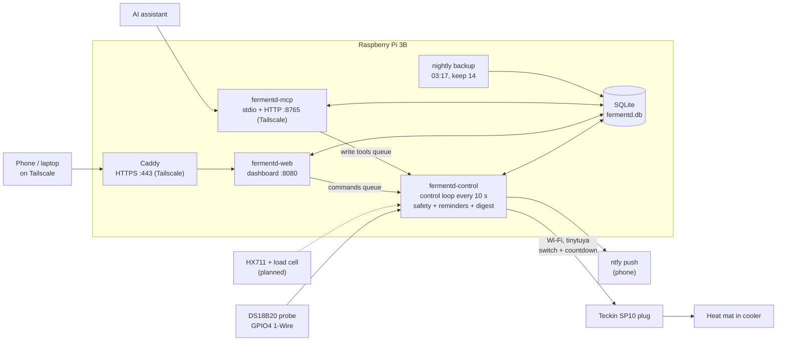

# fermentd

fermentd is a hobby fermentation controller that runs on a **Raspberry Pi 3 Model B**. It keeps a
cooler at the right temperature for cider, soda, ginger beer, ale, wine, kombucha and friends: a
DS18B20 probe reads the temperature, and a Teckin smart plug switches a seedling heat mat on and off
over Wi-Fi. Everything it sees and does goes into a SQLite database, shown on a small web dashboard
and available to an AI assistant through an MCP server.

It also walks you through each batch: step-by-step guides, reminders ("check the test bottle",
"move the bottles to the fridge"), hydrometer readings, tasting notes, recipe tweaks, photos, and a
weekly Sunday summary pushed to your phone.


## What it does

- **Holds a temperature** in one or more zones (one heat mat per zone), tuned per vessel type:
  a quick on/off thermostat for a jug, and timed hourly bursts for slow-to-warm bottles.
- **Stays safe on its own**: an 80°F hard cutoff, a 4-hour max on-time, probe-fault lockout, and a
  10-minute off-timer inside the plug itself that is re-armed every cycle, so the mat turns off even
  if the Pi dies.
- **Tracks batches** from "Making it" (Prep) through fermentation, bottling and the fridge, using
  28 built-in beverage profiles with recipes and guides.
- **Tells you when to act** with reminders and alerts on the dashboard and, optionally, your phone
  (ntfy).
- **Remembers everything**: gravity readings with ABV, tweaks you made to the recipe, saved
  "my version" variants, tastings with scores, notes with photos, and an activity log.
- **Talks to an AI assistant** over MCP (read tools plus a handful of clearly marked write tools).

## How it fits together



The control service is the only process that touches hardware. The dashboard and the MCP server
never switch the heater directly: they queue a command, and the controller checks it against the
safety rules before doing anything.

## Quick start (laptop, simulated hardware)

```bash
python3 -m venv .venv && source .venv/bin/activate
pip install -e ".[dev]"
pytest                                   # the whole suite runs without hardware
fermentd-demo --config config/fermentd.example.yaml   # a fast-forwarded ginger ale batch
```

Run the real services against the simulator (probes and plug are fake, the database goes in `data/`):

```bash
fermentd-control --config config/fermentd.example.yaml
fermentd-web     --config config/fermentd.example.yaml
```

Open http://127.0.0.1:8080. Copy `config/secrets.example.yaml` to `config/secrets.yaml` if you want
to try ntfy or the MCP HTTP server.

## Commands

| Command | What it does |
|---|---|
| `fermentd-control` | The control loop: probes, heater, safety, reminders, alerts, digest |
| `fermentd-web` | Web dashboard (FastAPI), default port 8080 |
| `fermentd-mcp` | MCP server; stdio by default, `--http --host <ip> --port 8765` for HTTP |
| `fermentd-mcp-public` | Optional public, read-only MCP server with OAuth, for cloud clients like Gemini (behind Tailscale Funnel) |
| `fermentd-ctl` | Helper CLI: `probes`, `heaters-off [--all]`, `plug-test <zone>`, `scale-read/tare/calibrate <vessel>`, `scale-test`, `planned-restart`, `set-password` |
| `fermentd-demo` | Simulated batch, for trying things out |

## Documentation

| Doc | Covers |
|---|---|
| [docs/hardware.md](docs/hardware.md) | Equipment list, wiring, what's planned |
| [docs/batches.md](docs/batches.md) | Vessels, zones, profiles, guides, batch lifecycle, reminders, gravity, tweaks, tastings, notes |
| [docs/control-and-safety.md](docs/control-and-safety.md) | How the heater is driven, safety layers, every alert type |
| [docs/mcp.md](docs/mcp.md) | MCP server and the full tool list |
| [docs/operations.md](docs/operations.md) | Pi setup, Tuya key, ntfy, deploying, HTTPS, backups |
| [docs/configuration.md](docs/configuration.md) | `fermentd.yaml` and `secrets.yaml` reference |
| [docs/recipes/](docs/recipes/) | Recipes behind the built-in profiles |
| [docs/DESIGN.md](docs/DESIGN.md), [docs/IMPLEMENTATION_PLAN.md](docs/IMPLEMENTATION_PLAN.md) | The original design notes (historical) |

## Security

The dashboard and MCP server control a heater, so keep them off the public internet: bind the
dashboard to `127.0.0.1` (behind a reverse proxy) or a Tailscale address, and set a dashboard
password with `fermentd-ctl set-password`, so changes need a login. `fermentd-web` refuses to
start on another address without one. Never commit `config/fermentd.yaml`, `secrets.yaml`,
`config/fermentd.env` or Tuya `devices.json`. See [SECURITY.md](SECURITY.md) to report a problem.

## Testing

```bash
pytest            # unit, integration and scenario tests; no Pi needed
ruff check .
```

Tests live in `tests/unit` (one file per area: safety, tuning, MCP, web, notifications, scale, ...),
`tests/integration` (the control service end to end with simulated hardware and a fake clock) and
`tests/scenarios` (a full ginger ale batch).

## License

MIT. See [LICENSE](LICENSE).

## Status

This is a one-person hobby project, built and run for real on a Pi in a basement. Heating only for
now; cooling (a chest freezer or mini fridge on a relay), the load-cell scale, and a room air probe
are planned. See [docs/hardware.md](docs/hardware.md).
