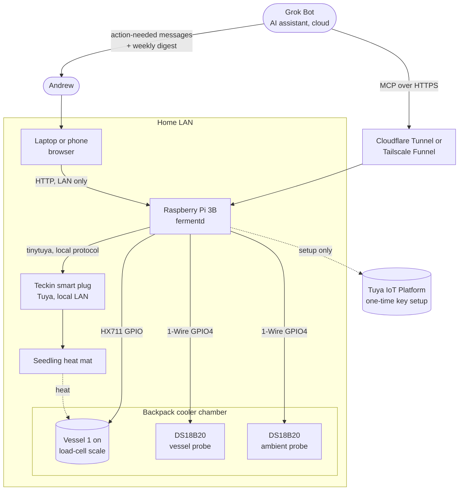
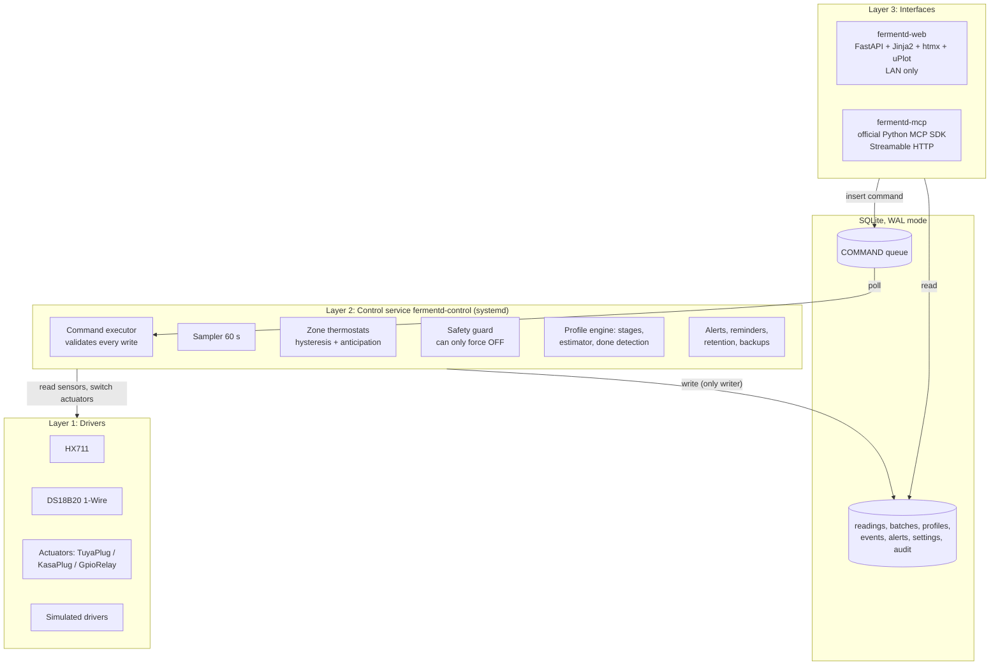
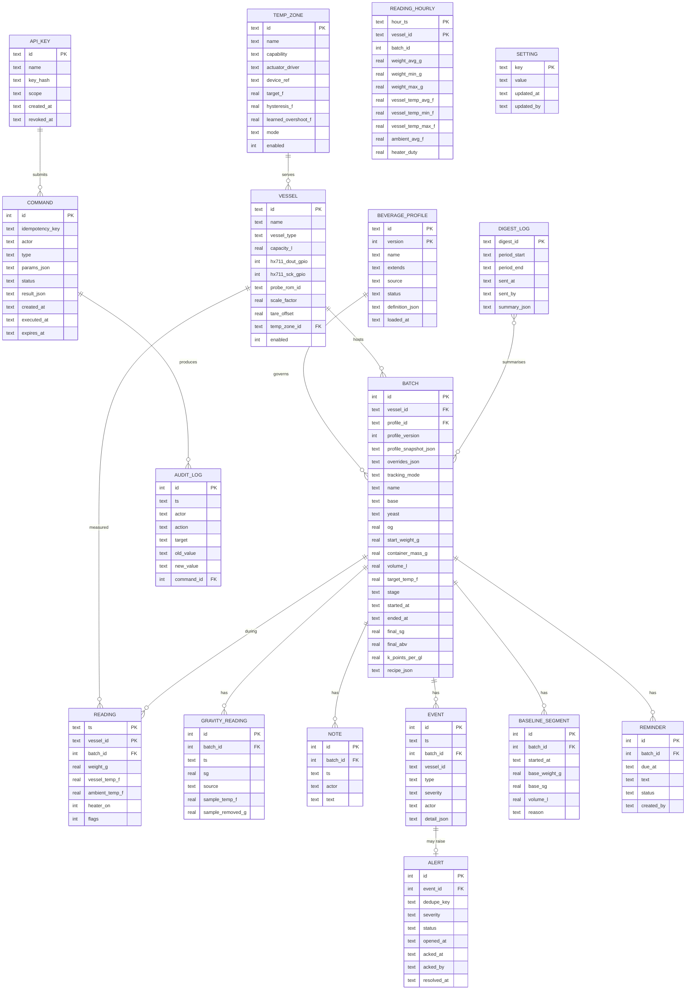
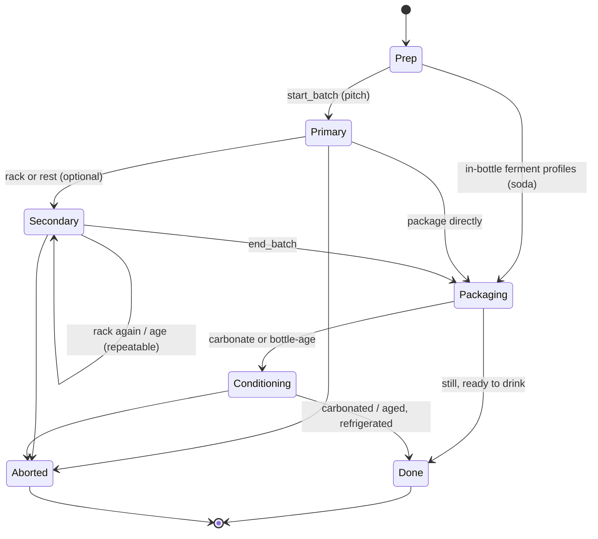
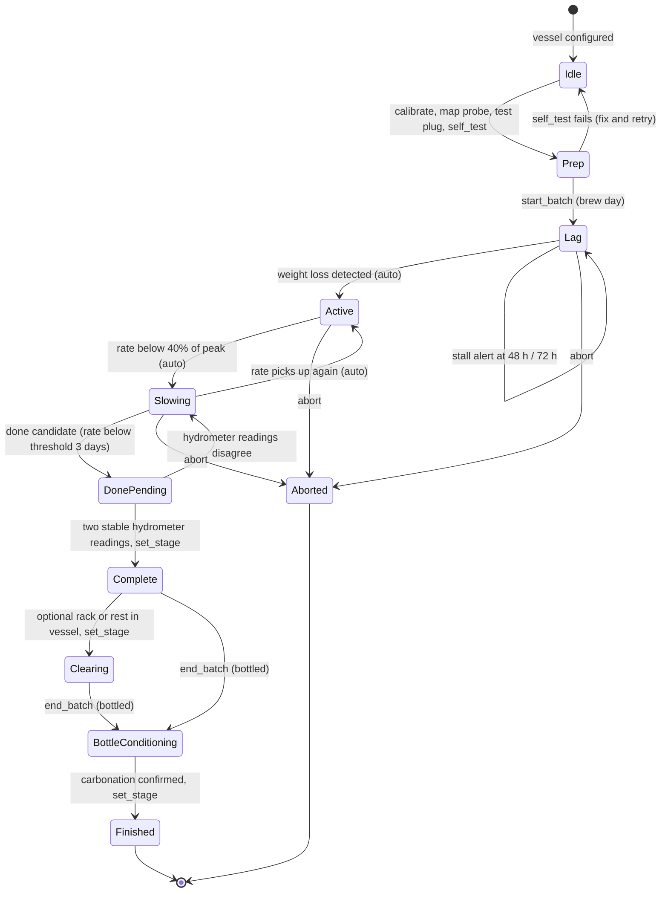

# fermentd: Home Fermentation Monitor and Controller: Design

> **Historical document.** This is the original plan from early October 2026. Some details changed while building it (for example the control tuning, the plug countdown, MCP write tools and the Prep stage). For how fermentd works today, see the [README](../README.md) and the other files in [docs/](.).

**Owner:** Andrew
**Status:** Draft v2 (adds beverage profiles and the weekly digest; first build is 1 vessel, scalable to N vessels)
**Date:** October 2026
**Companion document:** `IMPLEMENTATION_PLAN.md`

---

## 1. Summary

**fermentd** is a home fermentation monitor and controller. It watches and gently heats fermentation vessels (for v1, one-gallon glass jugs) in a cool spot of the house. Each batch follows a **beverage profile** (cider, wine, mead, ale, soda/ginger beer, kombucha/kefir) that sets its temperature range, stages, done rule, reminders and alerts. Cider is the default profile and the first batch, and it is the worked example throughout this document. A Raspberry Pi 3 Model B weighs each vessel continuously with a load cell, reads the vessel's temperature with a strapped-on DS18B20 probe, and switches a seedling heat mat through a Teckin (Tuya) smart plug controlled over the LAN. Because carbon dioxide leaves through the airlock as sugar ferments, the steady loss of weight gives a live estimate of specific gravity (SG) and alcohol by volume (ABV), which is corrected by occasional hydrometer readings.

Andrew sees everything on a small LAN-only web dashboard. Grok Bot (an AI assistant) reaches the same data through an MCP server and checks in about every 6 hours. It messages Andrew when something needs a human, and also sends one weekly digest. A single control service on the Pi owns the hardware and the safety rules, so no web click or AI request can bypass the safety guard.

The first build is one vessel, one temperature zone and one ambient probe. Adding vessel 2 means wiring one more scale and probe and adding about ten lines of YAML. No code changes.

### 1.1 Naming and glossary

**Project name: `fermentd`** (a fermentation daemon). It is short, beverage-neutral, and reads naturally in unit and package names (`fermentd-control`, `fermentd.control`). Alternatives considered: `brewwatch` (friendly, but "brew" leans toward beer), `vesselwatch` (clear but long), `ferment-pi` (ties the name to one board). If `fermentd` collides with something on PyPI or GitHub when the repo is created, `brewwatch` is the fallback (to check, uncertain).

| Name | Used for |
|------|----------|
| `fermentd` | Repository, Python package (`src/fermentd/`), service user, paths (`/etc/fermentd`, `/var/lib/fermentd`, `/opt/fermentd`), MCP server name |
| `fermentd-control`, `fermentd-web`, `fermentd-mcp` | The three systemd services and their entry points |
| `fermentd-ctl` | Command-line tool (probes, calibration, plug test, self-test, keys, backup) |

| Term | Meaning |
|------|---------|
| **Vessel** | Anything that holds a fermenting batch and has its own sensors: a 1-gallon jug (v1), a carboy, a bucket, a crock, or a bottle group (timer-only). `vessel_type` records which. Replaces "jug" as the generic entity. |
| **Batch** | One fermentation from start to finish, attached to one vessel (while it is on the scale) and one beverage profile. |
| **Beverage profile** | A named, versioned set of defaults and rules for a kind of drink (section 11). |
| **Tracking mode** | `weight` (scale-based SG/ABV estimate and done detection) or `timer` (scale ignored; reminders and temperature only). Set by the profile. |
| **Temperature zone** | One temperature-control actuator setup and the vessels it serves. v1 zones are heat-only (a heat mat on a smart plug); the abstraction allows a cooling actuator later. Replaces "heat zone". |
| **Actuator** | A device a zone switches: a heater in v1, possibly a cooler later. Drivers: TuyaPlug, KasaPlug, GpioRelay, Sim. |
| **Stage** | Where a batch is in its lifecycle. Every profile stage maps to one **core stage**: prep, primary, secondary, packaging, conditioning, done (plus aborted). |
| **Packaging** | Moving the batch out of the vessel into bottles (or kegs later). `end_batch` records it and frees the vessel. |
| **SG, OG, FG** | Specific gravity; original (start) and final gravity. One "point" is 0.001 SG. |
| **Digest** | The weekly Grok Bot summary message (section 15.3). |

---

## 2. Goals and non-goals

### 2.1 Goals

1. **Monitor** weight, vessel temperature and ambient temperature for each vessel every 60 seconds, and keep history.
2. **Control** temperature with heat only, holding a target (typically 60-65 F for cider; the range comes from the batch's profile) when the room is cooler than the target.
3. **Estimate** current SG and ABV from weight loss for profiles in weight-tracking mode, and recalibrate from manual hydrometer readings.
4. **Detect** fermentation stages (lag, active, slowing, complete) and prompt Andrew for the right action at the right time.
5. **Track the whole batch lifecycle**, from prep and brew day to bottling, bottle conditioning and batch history, including the parts where the vessel is not on the scale.
6. **Be safe by default.** The heater is off unless the control service is alive, has healthy sensors, and is actively deciding it should be on. Every limit is enforced on the Pi.
7. **Scale to N vessels** by configuration only.
8. **Be operable by an AI assistant** with scoped, rate-limited, audited, idempotent tools.
9. **Survive normal home failures** (power cuts, Wi-Fi drops, reboots, SD card wear) without losing the batch record or leaving the heater stuck on.
10. **Generalize beyond cider** through beverage profiles, without code changes for a new profile.
11. **Keep Andrew informed** with action-needed messages plus a short weekly digest.

### 2.2 Non-goals (v1)

- **Cooling.** There is no fridge, no fan cooling and no peltier. The system cannot pull temperature down. It can only tell Andrew. Profiles that need cooling (lager) are marked unsupported in v1; section 11.6 describes how a cooling zone plugs in later.
- Pressure fermentation, kegging, force carbonation.
- Backsweetened, carbonated cider that needs pasteurization (out of scope, and a bottle-bomb hazard; see section 12.7).
- Automatic dosing of anything (sugar, nutrients, sulfites).
- Internet-exposed web dashboard. Only the MCP endpoint is exposed, through a tunnel.
- Multi-user accounts, mobile app, cloud database.
- Wireless sensor nodes (a possible v3 path, see section 17).

---

## 3. Requirements

### 3.1 Functional

| ID | Requirement |
|----|-------------|
| F1 | Sample each enabled vessel's weight and temperature, plus ambient temperature, every 60 s. |
| F2 | Control each temperature zone with bang-bang plus hysteresis on the average of that zone's vessel probes (not air temperature). |
| F3 | Global hard target range 50-75 F, hysteresis 0.5-3 F. A batch's profile may narrow (never widen) the target range. Out-of-range requests are rejected with a reason, never silently clamped. |
| F4 | Estimate SG and ABV from weight loss; recalibrate on each manual gravity reading. |
| F5 | Detect lag-phase stall, fermentation completion, vessel removal and re-placement, and sensor faults. |
| F6 | LAN web dashboard showing per-vessel status, charts, alerts and notes, with confirmed actions. |
| F7 | MCP server with read, write and diagnostic tools, API keys with scopes, rate limits, idempotency and an audit log. |
| F8 | Grok Bot routine every ~6 h that messages Andrew when action is needed, plus a weekly digest. |
| F9 | Reminders that keep working after the vessel leaves the scale (bottle conditioning timers). |
| F10 | Batch history with comparisons across batches (within and across profiles). |
| F11 | Every batch uses a beverage profile (default `cider`). Profiles are built-in YAML, user-overridable, validated at load, and snapshotted into the batch at start. |
| F12 | Profiles in `timer` mode run on reminders and temperature only; the scale is ignored for estimates. |

### 3.2 Safety

| ID | Requirement |
|----|-------------|
| S1 | Heater maximum 4 h continuously on, then a forced 15 min rest. |
| S2 | Hard heater cutoff if any vessel or ambient probe exceeds 80 F. |
| S3 | Missing or implausible probe in a zone means that zone's heater goes off and a critical alert is raised. |
| S4 | Plug unreachable, or plug state not matching the commanded state, raises an alert. |
| S5 | Heaters default to OFF at service start, at service stop and after any crash or reboot. |
| S6 | Every state-changing action is audited with actor, old value and new value. |
| S7 | Safety rules run inside the control service and cannot be disabled by any API call. |

### 3.3 Non-functional

- Runs on a Raspberry Pi 3 Model B (1 GB RAM, quad-core, 2.4 GHz Wi-Fi only) with Raspberry Pi OS Lite and Python 3.
- Light on SD card writes.
- Fully testable on a laptop with simulated drivers.
- Simple enough that Andrew can debug it at 11 pm with `journalctl` and `sqlite3`.

---

## 4. System context



**Actors**

- **Andrew** does the physical work (sanitizing, pitching yeast, hydrometer readings, bottling) and uses the dashboard.
- **Grok Bot** reads state and performs safe writes through MCP, messages Andrew when action is needed, and sends a weekly digest.
- **Tuya cloud** is only used once to obtain the plug's device ID and local key. Normal operation is LAN-local.

---

## 5. Architecture

### 5.1 Layers



**Key rule:** `fermentd-control` is the only process that writes readings, changes settings, or touches hardware. The web and MCP processes read SQLite directly (cheap, fast) and express every change as a row in the `COMMAND` table. The control service validates the command with the same safety guard used by the control loop, applies it, audits it and writes the result back onto the command row. The caller waits (up to about 5 s) for the result and returns it.

### 5.2 Why a command table instead of a Unix socket

Both work. A command table is chosen for v1 because:

- It is durable: a command submitted while the control service is restarting is executed when it comes back (unless expired).
- It doubles as part of the audit trail.
- Idempotency keys are a unique index, so duplicate submissions are naturally detected.
- There is one IPC mechanism to test, and it is visible with plain `sqlite3`.

The cost is up to 1 s of polling latency, which is irrelevant for fermentation. A Unix-socket JSON API can be added later behind the same `CommandBus` interface if needed.

### 5.3 Processes

| Process | systemd unit | Role | Writes to DB? |
|---------|--------------|------|----------------|
| `fermentd-control` | `fermentd-control.service` | Hardware, control loop, safety, estimator, alerts, retention, command executor | Yes (everything) |
| `fermentd-web` | `fermentd-web.service` | LAN dashboard | Only `COMMAND` inserts |
| `fermentd-mcp` | `fermentd-mcp.service` | MCP server behind tunnel | Only `COMMAND` inserts and its own request log |
| tunnel | `cloudflared.service` or `tailscaled` | Public HTTPS to `fermentd-mcp` only | No |

Each process is small (tens of MB of RAM), well within the Pi 3's 1 GB.

### 5.4 Configuration versus database

- **YAML config** (`/etc/fermentd/fermentd.yaml`) is the source of truth for *hardware*: vessels, GPIO pins, probe ROM IDs, temperature zones and actuator drivers, plus default limits. Adding a vessel is a config change.
- **Profile YAML** (built-ins shipped in the package, overrides in `/etc/fermentd/profiles.d/`) is the source of truth for *beverage behaviour* (section 11). A batch stores a snapshot of its resolved profile at start, so editing a profile never changes a running batch.
- **Database** holds *runtime state*: calibration values, current targets, batches, readings, events.
- On startup, the control service upserts config vessels and zones into `VESSEL` and `TEMP_ZONE`. A vessel removed from config is marked `enabled = 0`, never deleted, so its history stays intact.
- Calibration (`scale_factor`, `tare_offset`) is written to the DB by calibration commands. The YAML may carry seed values for convenience.
- Targets: the DB value wins once set; YAML provides the default for a new zone.

---

## 6. Hardware design

### 6.1 Bill of hardware (v1, one vessel)

| Item | Qty | Status |
|------|-----|--------|
| Raspberry Pi 3 Model B, power supply, microSD | 1 | Owned |
| 10 kg straight-bar load cell + HX711 amplifier board | 1 per vessel | To buy |
| Scale platform: two rigid boards (plywood or MDF, roughly 20 x 20 cm) with bolts and spacers to sandwich the load cell | 1 per vessel | To buy or make |
| DS18B20 waterproof probe | 1 per vessel + 1 ambient | To buy |
| 4.7 kOhm resistor (1-Wire pull-up) | 1 total | To buy (often included with probes) |
| Jumper wires, breadboard | some | Breadboard owned |
| Seedling heat mat | 1 per temperature zone | Owned |
| Teckin smart plug (Tuya) | 1 per temperature zone | Owned |
| Backpack cooler as the chamber | 1 | Owned (fit to be measured in the dry run, section 6.2) |
| Foam/insulation patch and tape for the vessel probe | 1 per vessel | To buy or scrounge |

### 6.2 Physical layout

```
          +---------------- backpack cooler (lid closed, or cracked / notched) ---+
          |                                                                       |
          |      airlock                                                          |
          |        |                                                              |
          |     .--+--.   <- #6 stopper                                           |
          |    /       \                                                          |
          |   |  1 gal  |  <- DS18B20 taped mid-height, foam patch over it        |
          |   |  jug    |=[probe]                                                 |
          |   |         |                     [ambient DS18B20, hung mid-air,     |
          |   '---------'                      away from the mat and the walls]   |
          |  ===========  <- top board                                            |
          |    [==LC==]   <- load cell (bolted top board one end, bottom other)   |
          |  ===========  <- bottom board                                         |
          |  heat mat leaning against the vessel side or on the cooler floor beside  |
          |  the scale, NOT trapped between the scale boards                      |
          +-----------------------------------------------------------------------+
     cables exit through a notch in the lid, with a slack loop and strain relief
```

**Backpack cooler fit (measure in the M7 dry run).** The chamber is a soft-sided backpack cooler. Check before committing:

- **Height:** scale platform (two boards plus load cell and spacers, roughly 4-6 cm, measure yours) + jug height + stopper + airlock (a 3-piece or S-type airlock adds roughly 10-15 cm, uncertain by model). If that exceeds the interior height, the lid cannot close. Options: leave the lid cracked and drape a towel over the opening, cut or use a zip gap as a notch for the airlock, or switch to a shorter airlock (a low-profile or blow-off-tube-to-jar setup also changes height).
- **Footprint:** the platform (about 20 x 20 cm) must sit flat on the cooler floor. Soft cooler floors sag; put a rigid board under the platform so the load cell sees a stable base, and keep the platform from touching the walls.
- **Cable exit:** probe, HX711 and mat cables need a path out (zipper gap or a small notch) that does not pinch them; pinched cables pull on the scale.
- **Insulation and sealing:** soft coolers insulate less than hard ones, which reduces the mat's authority in a cold room and helps in a warm one. The dry run measures how far above ambient the mat can hold the water.
- **Heat:** keep the mat off the cooler's liner where it could concentrate heat in one spot; seedling mats run cool, but check the liner after the stuck-on test.

Practical notes that matter for weight accuracy:

- **Cables pull on scales.** The probe cable taped to the vessel and the heat mat cable can each add or remove several grams as they shift. Leave a loose slack loop between the vessel and the cooler wall and tape the cable to the cooler wall, not to the floor of the scale.
- **Mat placement.** Prefer the mat standing against the side of the vessel (wrapped partially around it, held with a strap) or on the cooler floor next to the scale. If it must go under the vessel, it must sit on the top board so it is part of the constant tare, with its cable given a slack loop. Do not put it under the bottom board, where it heats the load cell (load cells drift with temperature).
- **Load cell orientation.** Straight-bar load cells have an arrow showing the load direction. Bolt the fixed end to the bottom board and the free end to the top board, with spacers so the bar can flex. Nothing else may touch the top board.
- **Weight budget.** A full 1-gallon glass jug is roughly 5-6 kg total (glass weight varies by vessel, uncertain, weigh yours), comfortably under 10 kg.

### 6.3 Temperature probe placement

- v1: DS18B20 taped to the outside of the vessel at mid-height, covered by a foam or closed-cell insulation patch so it reads glass and liquid rather than chamber air. Expect it to read slightly closer to ambient than the true liquid temperature and to lag a little. With a gallon of liquid the thermal mass is large, so the error is small in steady state (likely under 1 F, to be checked in the water dry run).
- Option (later): a thermowell through a 2-hole #6 stopper, with the airlock in the other hole. More accurate and faster, but another thing to sanitize and seal, and the probe cable on the stopper can tug on the scale.
- Ambient probe: hung in chamber air, away from the mat and walls. It is used for safety, for the "ambient pushing above target" alert and for the learned control model, not for control itself.

### 6.4 Wiring

**1-Wire bus (all DS18B20s):** one shared data line on GPIO4 (physical pin 7), powered mode (not parasitic).

```
Pi 3.3V (pin 1) ---+-------------------+---------------- red   (VDD) of every DS18B20
                   |                   |
                 [4.7k]                |
                   |                   |
Pi GPIO4 (pin 7) --+-------------------+---------------- yellow (DQ) of every DS18B20
Pi GND   (pin 6) -----------------------+--------------- black (GND) of every DS18B20
```

(Probe wire colors vary by vendor; check the listing.) Use a short bus or a short daisy chain with short stubs. For 2-6 probes within a metre or two this is very reliable.

**HX711 per vessel:** the HX711 board is powered from **3.3 V**, so its DOUT output is 3.3 V logic and safe for the Pi GPIO. Do not power it from 5 V unless the board has a separate logic-level supply pin (VDD) tied to 3.3 V, because a 5 V DOUT can damage a Pi GPIO.

```
Load cell        HX711            Pi
red    (E+) ---> E+
black  (E-) ---> E-
white  (A-) ---> A-               (if readings go negative under load, swap A+ and A-)
green  (A+) ---> A+
                 VCC  ----------> 3.3V (pin 1 or 17)
                 GND  ----------> GND
                 DT/DOUT -------> vessel's DOUT GPIO
                 SCK/PD_SCK ----> vessel's SCK GPIO
```

Use channel A, gain 128, and the default 10 samples/s rate.

### 6.5 GPIO allocation

Pins avoided on purpose: GPIO2/3 (I2C, kept free for a future I2C ADC or display), GPIO14/15 (UART, handy for a serial console), GPIO7-11 (SPI, kept free). GPIO4 is the 1-Wire bus.

| Function | BCM GPIO | Physical pin | Notes |
|----------|----------|--------------|-------|
| 1-Wire bus (all DS18B20) | 4 | 7 | 4.7k pull-up to 3.3 V |
| Vessel 1 HX711 DOUT / SCK | 5 / 6 | 29 / 31 | v1 |
| Vessel 2 HX711 DOUT / SCK | 13 / 19 | 33 / 35 | |
| Vessel 3 HX711 DOUT / SCK | 26 / 20 | 37 / 38 | |
| Vessel 4 HX711 DOUT / SCK | 16 / 12 | 36 / 32 | |
| Vessel 5 HX711 DOUT / SCK | 23 / 24 | 16 / 18 | |
| Vessel 6 HX711 DOUT / SCK (stretch) | 17 / 27 | 11 / 13 | |
| Heater relay zone 1 (only if GPIO relay fallback is used) | 18 | 12 | Digital Loggers IoT Relay input |
| Heater relay zone 2 (optional) | 22 | 15 | |
| Status LED (optional) | 25 | 22 | heartbeat |
| Spare | 21 | 40 | |
| 3.3 V | | 1, 17 | HX711s and DS18B20s; budget well under 50 mA total, fine |
| 5 V | | 2, 4 | not used by sensors |
| GND | | 6, 9, 14, 20, 25, 30, 34, 39 | |

**How many vessels, and why the limit.** With the pins above there are dedicated DOUT/SCK pairs for 6 vessels without touching I2C, SPI or UART, and 7 or more if those buses are sacrificed. The recommended practical limit for a Pi 3 is **4-5 vessels**, because:

1. **HX711 bit-banging timing.** The HX711 is read by toggling SCK 25 times. If SCK stays high for more than about 60 microseconds, the chip powers down and the read is corrupted. Python on Linux is not real-time, so occasional bad reads happen. They are handled with retries and median filtering, but each extra vessel adds read time (10 samples/s means about 1.5 s per vessel for 15 samples) and more chances of a glitch.
2. **Wiring.** Each HX711 should sit near its scale, with short leads back to the Pi. Five scales in one cooler or shelf is about the physical limit of a tidy single-Pi harness.
3. **Temperature zones.** One mat per zone; a Pi can switch many plugs, but each Tuya plug is another Wi-Fi device to keep healthy.

**Beyond 5 vessels:** move to I2C 24-bit ADCs (for example NAU7802 boards, which share one I2C address and so need a TCA9548A I2C multiplexer), or put a small microcontroller (for example an ESP32) per shelf that reads its HX711s in real time and reports to the Pi. The driver interface (`WeightSensor`) is designed so either can be dropped in.

### 6.6 Heater hardware and the Teckin plug

- Seedling heat mats are low wattage (typically around 10-25 W for a small mat, check the label) and are designed to warm a surface a modest amount above ambient. Inside an insulated cooler, though, even a small mat running continuously can raise the chamber temperature substantially over many hours. The design treats "mat stuck on" as a real, bounded risk (section 8.4), not as harmless.
- The Teckin plug is a Tuya-platform device. After a one-time Tuya IoT Platform setup to obtain the device ID and local key, `tinytuya` controls it directly on the LAN. Data point (DP) 1 is normally the switch.
- **Test first.** Some newer Teckin firmware may block or change local control (uncertain; it varies by model and firmware batch). Milestone M0 includes a plug test before anything else depends on it.
- **Plug power-on behaviour.** If the Smart Life app offers a "relay status after power loss" or similar setting, set it to OFF.
- **Countdown data point (check).** Many Tuya plugs expose a countdown DP (often DP 9) that turns the relay off after N seconds. Teckin plugs are generally assumed to lack an on-device auto-off, but if your plug does expose a countdown DP, the design uses it as a hardware dead-man timer (section 8.4). Treat this as uncertain until tested.
- **Fallbacks**, behind the same `Actuator` interface:
  - `KasaPlug` via `python-kasa` (TP-Link Kasa plugs, local LAN control). Some models support an on-device auto-off or countdown feature (verify for the model you buy).
  - `GpioRelay` driving a Digital Loggers IoT Relay from a GPIO. This is the most robust option: no Wi-Fi, and if the Pi loses power or the GPIO goes low after a reboot, the relay is off.
- **Optional hardware backstop (recommended if you keep the Tuya plug):** an independent plug-in thermostat controller of the kind sold for seedling mats, placed between the smart plug and the mat, with its own probe in the chamber and set to about 78 F. It caps the worst case regardless of software or Wi-Fi.

---

## 7. Temperature zones and actuators

### 7.1 Zones

A **temperature zone** is a set of actuators (in v1, one heater) and the set of vessels it serves. Every vessel maps to exactly one temperature zone (or to none, for monitor-only vessels). Each zone has a `capability`: `heat` (v1), and later `cool` or `heat_cool` (section 11.6).

- v1: one zone `zone1`, one mat, one plug, containing `vessel1`.
- Shared mat for several vessels: all of them list `temp_zone: zone1`. The zone's control temperature is the **average** of its vessels' probes, and the safety guard watches each probe individually.
- One mat per vessel later: create `zone2` with its own plug and set `vessel2.temp_zone: zone2`. No code change.

Rules:

- Zone control temperature = mean of probe temperatures of vessels in the zone that are enabled, in place (on the scale, or for timer-mode vessels simply present), and have a healthy probe. Vessels with an active batch are preferred; if the zone has no active batch, the heater stays off (no point heating water or an empty scale) unless the zone is in `test` mode during a dry run.
- If any vessel probe in the zone is faulted, the whole zone's heater is turned off (fail safe) and a critical alert is raised. Reasoning: with a shared mat, heating "blind" on the remaining probes could overheat the vessel that is not being measured.
- A zone may also list `extra_probes` (for example a mat-surface probe later) used only by the safety guard.
- **Profile compatibility.** All active batches in one zone must have overlapping allowed target ranges (from their profiles). `start_batch` rejects a batch whose profile range does not overlap the zone's current batches (for example kombucha at 74 F and cider at 62 F in one shared-mat zone) and suggests a separate zone. A profile that needs a capability the zone lacks (lager needs `cool`) is rejected with `PROFILE_UNSUPPORTED`.

### 7.2 Actuator (heater) interface

```python
class Actuator(Protocol):                         # heaters in v1; coolers later
    id: str
    def set(self, on: bool) -> None: ...          # raises ActuatorUnreachable
    def read_state(self) -> bool | None: ...      # None = unknown/unreachable
    def supports_countdown(self) -> bool: ...
    def arm_countdown(self, seconds: int) -> None: ...  # hardware dead-man, if supported
    def close(self) -> None: ...
```

Implementations: `TuyaPlug` (tinytuya), `KasaPlug` (python-kasa), `GpioRelay`, `SimHeater` (tests, with a thermal model), and `NullHeater` (monitor-only zones).

Every switch is followed by a **read-back verify**: `set(on)`, wait about 1 s, `read_state()`. A mismatch is retried once, then raises a `heater_state_mismatch` alert. The service also re-asserts the desired state every cycle (idempotent), so a plug that rebooted, or was toggled in the Smart Life app, is corrected within a minute and logged.

---

## 8. Control loop and safety

### 8.1 Main loop timing

| Task | Period | Notes |
|------|--------|-------|
| Command executor | 1 s | Poll `COMMAND` for `pending` rows |
| Thermostat and safety evaluation | 10 s | Uses latest temperatures |
| Temperature read (all DS18B20) | 10-15 s | Bulk conversion; about 750 ms per conversion at 12-bit |
| Weight read (all HX711) | 60 s | 15 samples per vessel, median |
| Write `READING` rows | 60 s | One transaction per minute |
| Estimator, stage detection, alert rules | 5 min | |
| Plug state verify | 60 s | And after every switch |
| Retention / downsample / backup | daily, 03:30 local | |
| systemd watchdog ping | 10 s | `WatchdogSec=60` |

Temperatures are sampled more often than they are stored so that the safety guard reacts quickly, while the database only gets one row per vessel per minute.

### 8.2 Sensor processing

**DS18B20:** read from sysfs (`/sys/bus/w1/devices/28-*/temperature`, or `w1_slave` with its CRC line). A reading is rejected if the CRC fails, if it is exactly 85.0 C (power-on default, means a failed conversion), -127 C or similar sentinel values, outside a plausible window (32-120 F), or if it changes faster than 5 F per minute (a gallon of liquid cannot do that). Three consecutive rejects or a missing device file marks the probe **faulted**.

**HX711:** take 15 raw samples, discard reads that are all ones or out of the 24-bit range, take the median, convert with `grams = (raw - tare_offset) / scale_factor`. Then:

- Spike filter: if the new minute value differs from the median of the last 5 minutes by more than 30 g, hold it as "pending" for up to 3 minutes before accepting it as a real step (vessel bumped vs vessel changed).
- **Vessel-off-scale:** weight below 50% of the batch's container mass, or a drop of more than 1000 g at once, raises a `vessel_off_scale` event and pauses the estimator and done-detection.
- **Step change:** a confirmed step between 30 g and 1000 g (hydrometer sample taken, airlock refilled, something set on the board) raises a `weight_step` event and asks for classification (see section 10.6).
- Optional temperature compensation: `grams_corrected = grams - k_temp * (T_ambient - T_cal)`, with `k_temp` fitted from the water dry run (M7). Starts at 0.

### 8.3 Thermostat: bang-bang with hysteresis and learned anticipation

For each zone with target `T_set` and hysteresis `h`:

- Control temperature `T` = average of the zone's healthy vessel probes.
- Heater turns **ON** when `T <= T_set - h`.
- Heater turns **OFF** when `T >= T_set - a`, where `a` is the learned anticipation (0 <= a <= h/2 + 0.5 F, starts at 0).
- Otherwise, keep the current state.
- Minimum on time 5 min and minimum off time 5 min (protects the plug relay and avoids chatter from probe noise). Safety overrides always pre-empt minimum times.

**Learned anticipation.** Because the mat keeps heating the vessel after it turns off, temperature keeps rising (overshoot). After each off-transition the service records the peak temperature in the following 60 minutes. `overshoot = peak - T_at_off`. It keeps an exponentially weighted average (`alpha = 0.3`) per zone and sets `a = clamp(ewma_overshoot, 0, h/2 + 0.5)`. Learned values are stored in `TEMP_ZONE.learned_overshoot_f` and survive restarts. Overshoot learning is skipped if the cycle was cut short by a safety rule, a sensor fault or a target change.

The result: the vessel temperature rides in roughly `[T_set - h, T_set]` with little overshoot, and the controller adapts to the mat, the cooler and the season without tuning.

**Why not PID?** A slow, heat-only plant switched by a relay with minimum on/off times is well served by hysteresis. PID adds tuning effort for no practical benefit at this precision (plus or minus 1 F is excellent for cider).

### 8.4 Safety guard

The safety guard runs every evaluation tick, before the thermostat output is applied, and it can only ever force a heater **off**. It never turns anything on.

| Rule | Condition | Action | Clears when |
|------|-----------|--------|-------------|
| Overtemp hard cutoff | Any vessel or ambient probe > 80 F (`safety.cutoff_f`) | All heaters in affected zone(s) off; latch; critical alert | All probes < 78 F for 15 min (auto), event logged |
| Sensor fault | Zone probe missing, CRC failures, implausible value, ambient probe faulted | Zone heater off; critical alert | Probe healthy for 5 consecutive minutes |
| Max continuous on | Heater on for 4 h (`max_on_minutes: 240`) | Force off for 15 min (`rest_minutes: 15`); info event | After rest |
| Duty budget (optional) | Heater on more than 20 h in 24 h | Warning alert ("mat is struggling, chamber too cold or lid open?") | Next day |
| No-heat-effect | Heater on 2 h and zone temperature rose less than 0.3 F | Warning alert (mat unplugged, failed, or not touching the vessel) | Next successful rise |
| Plug unreachable | 3 consecutive failed reads (about 3 min) | Alert; keep retrying with backoff | Plug reachable and state verified |
| State mismatch | Read-back differs from commanded state after a retry | Alert (critical if it is ON when it should be OFF) | Match |
| Clock or loop stall | Loop did not complete in 60 s | systemd watchdog restarts the service; on start the heater is set OFF | Restart |
| Startup | Service start | All heaters OFF and verified before the loop begins; no heating until fresh sensor data exists | n/a |
| Shutdown | Service stop or crash | `ExecStopPost` turns all heaters OFF | n/a |
| Last resort | Pi hang | Hardware watchdog (`RuntimeWatchdogSec`) reboots the Pi; heater forced OFF on boot | n/a |
| Profile target bound | Zone target outside the intersection of the global hard range (50-75 F) and every active batch's profile `allowed_target_f` | Heater OFF for that zone and a `config_conflict` action alert (this can only happen if a profile override is edited while a batch is running; commands are already validated) | Target back in range |

Durations use the monotonic clock, so an NTP jump cannot shorten or extend them.

**Global limits versus profile limits.** The global limits (target 50-75 F, hysteresis 0.5-3 F, hard cutoff 80 F, 4 h max on) live in the main config and in code defaults, and **no profile can loosen them**. A profile can only tighten: narrow the allowed target range, lower the cutoff (for example a profile could cut off at 78 F), shorten max on-time. Profile loading fails validation if a profile tries to widen a global limit.

**The Wi-Fi-drop risk.** If Wi-Fi drops while the Tuya plug is on, the Pi cannot turn it off, and the plug has no idea anything is wrong. It simply stays on until Wi-Fi returns. The 4 h limit and the 80 F cutoff are both enforced on the Pi, so neither can reach the plug in this situation. Mitigations, in order of strength:

1. **Countdown dead-man (if the plug supports it).** Every time the controller turns the mat on, and again every few minutes while it stays on, it arms the plug's countdown DP for 15 minutes. If the Pi or Wi-Fi disappears, the plug switches itself off within 15 minutes. This turns the worst case from "unbounded" into "15 more minutes of a small mat". Verify in M0 that the countdown actually switches the relay off with the Pi disconnected.
2. **Independent hardware thermostat** between the plug and the mat, set to about 78 F. Caps the worst case regardless of software.
3. **GpioRelay fallback** (Digital Loggers IoT Relay): no Wi-Fi in the loop at all.
4. **Physics and placement.** A gallon of liquid in a cool basement heats slowly; a small seedling mat raising it from 62 F to 80 F would take many hours (to be measured in the dry run). Keep the cooler lid cracked slightly rather than sealed, and keep the chamber in a cool room so the equilibrium temperature with the mat stuck on stays moderate. The dry run (M7) includes a deliberate "mat stuck on" test to measure the actual equilibrium temperature with this mat and cooler.
5. **Alerting.** Plug unreachable for more than 3 minutes while it was last commanded ON is a **critical** alert, which Grok Bot passes on at its next check, and the dashboard shows a red banner. (If the Pi itself lost Wi-Fi, Grok Bot will notice that it cannot reach the MCP server; see section 15.)
6. **Wi-Fi hygiene:** reserve a DHCP address for the plug and the Pi on the router, keep both on 2.4 GHz, and keep the plug within good range.

Decision for v1: use the Tuya plug if it passes the M0 test. Use the countdown DP if it exists. If it does not exist, strongly consider the hardware thermostat backstop or switching to the GPIO relay before leaving the system unattended for days.

### 8.5 "Too warm and nothing can be done"

There is no cooling. When the zone temperature is above `T_set + over_margin` (default 2 F) for more than 2 hours with the heater off, the system raises `temp_above_target_uncontrolled`. Typical causes are a warm room, or the heat that active fermentation itself produces (a vigorous gallon can run a few degrees above its surroundings). The message suggests what a human can do:

- Open or remove the cooler lid (the insulation is now working against you).
- Move the chamber to a cooler spot (basement floor, away from the furnace or water heater).
- Add frozen water bottles to the cooler, swapping them twice a day (a manual "swamp cooler").
- Wrap the vessel in a wet towel with a fan blowing across it (evaporative cooling).
- Accept it: champagne-type yeasts tolerate a wide range, but warm, fast fermentations can produce more fusel and sulfur aromas.

Severity escalates to `action` if the vessel exceeds the profile's `alerts.warm_action_f` during primary fermentation (72 F for cider), and to `critical` at the safety cutoff.

**Placement recommendation.** Put the chamber somewhere whose ambient temperature is a few degrees below the target, for example a 55-60 F basement with a 62 F target. Then the mat does small amounts of work, the controller has authority, and the "too warm" case is rare.

---

## 9. Data model

### 9.1 Entity-relationship diagram



### 9.2 Table notes

- **Timestamps** are ISO 8601 UTC strings (`2026-10-12T09:43:00Z`). The UI converts to local time (America/New_York).
- **`READING`** has a composite primary key `(ts, vessel_id)`, one row per vessel per minute. `ambient_temp_f` is repeated per vessel (cheap and simplifies queries). `flags` is a bitfield: `1 = weight pending/spike`, `2 = vessel off scale`, `4 = probe fault`, `8 = clock not synced`, `16 = safety lockout active`.
- **`BATCH.stage`** holds a stage id from the batch's profile snapshot (for cider: `lag, active, slowing, complete, clearing, bottle_conditioning, finished`, plus `aborted` for every profile). The core stage (prep, primary, secondary, packaging, conditioning, done) is derived from the profile (section 11.4). `stage` changes are always audited.
- **`BATCH.profile_id`, `profile_version`, `profile_snapshot_json`** pin the resolved profile used by the batch; `overrides_json` holds the per-batch overrides; `tracking_mode` (`weight` or `timer`) is copied from the profile for fast queries. `base` replaces the cider-specific `juice` field (juice, must, wort, sweet tea, sugar water).
- **`BEVERAGE_PROFILE`** stores every resolved profile version (`source` = `builtin` or `user`, `status` = supported / experimental / unsupported_v1), so history can always show exactly which rules a past batch ran under.
- **`VESSEL.vessel_type`** is `jug`, `carboy`, `bucket`, `jar` or `bottle_group`; `capacity_l` is used for headspace guidance. A vessel with no HX711 configured is timer-only.
- **`TEMP_ZONE.capability`** is `heat` in v1 (`cool` and `heat_cool` reserved, section 11.6); `actuator_driver` replaces the heater-only `driver_type`.
- **`DIGEST_LOG`** records each weekly digest (`digest_id` is the ISO week, for example `2026-W42`) so the routine never sends the same week twice.
- **`BATCH.container_mass_g`** is the empty vessel + stopper + airlock (with its water) mass, weighed during brew day. It lets the system compute liquid mass and volume. If unknown, the user can enter `volume_l` directly.
- **`BATCH.k_points_per_gl`** is the calibration constant of the estimator (section 10). Default 1.0.
- **`BASELINE_SEGMENT`** handles vessel removal, racking, samples and airlock top-ups: each segment has its own base weight and anchor SG, so cumulative loss is the sum over segments.
- **`ALERT`** turns events into something that can be acknowledged. `dedupe_key` (for example `stall:batch:3`) prevents the same condition from opening duplicate alerts. Statuses: `open, acked, resolved`.
- **`COMMAND.idempotency_key`** has a unique index together with `actor`. `status` is `pending, done, rejected, expired, error`.
- **`API_KEY.key_hash`** stores a SHA-256 (or argon2) hash, never the key. `scope` is `read`, `full` or `diag`.
- **SQLite pragmas:** `journal_mode=WAL`, `synchronous=NORMAL`, `foreign_keys=ON`, `busy_timeout=5000`. Readers (web, MCP) open the database read-only except for `COMMAND` inserts.

### 9.3 Retention

- Raw `READING` rows are kept for 30 days, then rolled into `READING_HOURLY` (avg, min, max, heater duty) and deleted. Rows belonging to an active batch are kept raw until the batch has been ended for 30 days, so every batch's active phase can be inspected at full resolution for a while.
- One vessel produces about 1,440 rows a day, about 43,000 per 30 days, a few MB. Even 5 vessels for years stays tiny.
- `EVENT`, `AUDIT_LOG`, `GRAVITY_READING`, `NOTE`, `BATCH` are kept forever.
- `COMMAND` rows older than 90 days are deleted (their effects live on in `AUDIT_LOG`).

---

## 10. Gravity and ABV estimation

This section applies to batches in `weight` tracking mode (cider, wine, mead, ale). Timer-mode profiles skip it (section 11.7). Profile values (`k_points_per_gl`, `dissolved_co2_gl`, `abv_formula`, done thresholds) feed the formulas below.

### 10.1 The chemistry, in one paragraph

Yeast converts sugar to ethanol and CO2. For glucose: C6H12O6 -> 2 C2H5OH + 2 CO2, which by molar mass is 180 g of sugar -> 92 g of ethanol + 88 g of CO2, so ethanol and CO2 are produced in nearly equal masses. Balling's classic empirical balance (which accounts for yeast growth) is 2.0665 g of extract -> 1 g ethanol + 0.9565 g CO2 + 0.11 g yeast. The ethanol stays in the vessel; the CO2 leaves through the airlock. **So the mass the vessel loses is, to a good approximation, the CO2 produced, and roughly equal to the ethanol produced.**

### 10.2 Formulas

Definitions for the current baseline segment:

- `OG` = original gravity measured with the hydrometer (for example 1.050).
- `W0` = gross weight at batch start (g), `Wt` = gross weight now (g).
- `C` = container mass (vessel + stopper + airlock with water) in g.
- `V` = liquid volume in litres. From weight: `V = (W0 - C) / (OG * 998.2)` (998.2 g/L is water at about 68 F; good enough).
- `dm = W0 - Wt - drift(t)` = mass lost to CO2 (g), with `drift(t)` the evaporation and creep correction (section 10.4).

Ethanol produced (g), from Balling:

```
m_ethanol = dm / 0.9565
```

ABV (percent by volume), with ethanol density 0.789 g/mL:

```
ABV_est = (m_ethanol / 0.789) / (V * 1000) * 100
        = 0.1325 * dm / V              (dm in g, V in L)
```

Estimated current gravity. The standard homebrew relation `ABV = 131.25 * (OG - SG)` combined with the line above gives a convenient rule of thumb: **about 1 g of CO2 lost per litre per gravity point** (one point = 0.001 SG). In formula form:

```
SG_est = OG - k * 0.001 * (dm / V)
ABV_est = 131.25 * (OG - SG_est)
```

with `k` (`k_points_per_gl`) = 1.0 by default (the theoretical value works out to about 1.01). `k` is the knob that manual hydrometer readings tune.

**Worked example (typical 1-gallon cider).** OG 1.050, about 3.6 L of juice in the vessel. Fermenting to 0.998 is 52 points, so the vessel should lose about `52 * 3.6 = 187 g`. ABV at the end: `131.25 * (1.050 - 0.998) = 6.8%`. A 10 kg load cell read by an HX711 resolves about 1 g after median filtering, so the estimator has roughly 190 steps of resolution across the whole fermentation. That is plenty.

### 10.3 Assumptions

1. All mass lost is CO2 (plus a small, measurable evaporation term).
2. Nothing is added or removed from the vessel except in recorded events (samples, top-ups, racking).
3. The liquid volume is roughly constant (true within a few percent).
4. The hydrometer relation `131.25 * (OG - FG)` is the standard approximation and is reasonable below about 8-9% ABV; at higher ABV it underestimates slightly. Profiles for wine and mead select `abv_formula: high_gravity`, which uses `ABV = (76.08 * (OG - FG) / (1.775 - OG)) * (FG / 0.794)`.

### 10.4 Error sources and how each is handled

| Source | Effect | Handling |
|--------|--------|----------|
| Dissolved CO2 | The first 1.5-2 g/L of CO2 stays dissolved (cider saturates at roughly 0.8-1 volume at cellar temperature), so early weight loss lags the true gravity by roughly 1.5-2 points. A little more comes out when the vessel warms or is moved. | Absorbed by `k` and by recalibration. Optionally add a fixed `dissolved_co2_gl` offset (default 0, set from experience). Shown as an error band. |
| Evaporation through the airlock | The airlock water and a little of the cider's water vapour evaporate, perhaps a gram or so per day (uncertain, measured in the water dry run). Over 3 weeks this matters. | `drift(t) = evap_g_per_day * days`, measured in M7 with a water-filled vessel and airlock; refined when the batch is finished and weight is flat. |
| Airlock liquid | Topping up the airlock adds weight; airlock liquid can be sucked into the vessel by temperature drops. | Top-ups are recorded as a `weight_step` and rebaselined. Use a 3-piece airlock filled to the line, or a vodka/Star San fill. |
| Vessel bumps, things set on the scale | Transient spikes or steps. | Median filter, 3-minute pending window, step classification. |
| Hydrometer samples | A 100-150 mL sample removes 100-150 g, which would look like a decade of CO2. | The step detector catches it; `record_gravity` takes an optional `sample_removed_g` and creates a new baseline segment. Prefer returning the sample only if everything is sanitized; otherwise discard it. |
| Load cell creep | Under constant load, strain gauges creep slowly, often a few grams over days (uncertain, cell-dependent). | Measured during the 48 h water dry run; folded into `drift(t)`. Leave the platform loaded with the water vessel for a day before calibrating. |
| Temperature drift of the load cell and HX711 | Zero and span shift with temperature. The mat cycling makes this worse if it heats the cell. | Mat not under the bottom board; optional `k_temp` compensation fitted in the dry run. |
| Cable tug | The probe cable changes the apparent weight. | Slack loop and strain relief. |
| Volume uncertainty | Error in `V` scales the estimate proportionally. | Weigh the empty vessel (`container_mass_g`) on brew day. |

Typical realistic accuracy after one manual calibration: within about 2-3 gravity points through active fermentation, closer near the end. The dashboard shows the estimate with a "plus or minus" band that widens with time since the last manual reading.

### 10.5 Recalibration from hydrometer readings

`record_gravity(batch_id, sg, sample_temp_f?, sample_removed_g?)`:

1. Apply hydrometer temperature correction if `sample_temp_f` is given (hydrometers are typically calibrated at 60 F, some at 68 F; check yours, configured as `hydrometer_cal_temp_f`).
2. Compute `dm` at the reading time from the filtered weight series.
3. If `dm / V` is large enough (at least 5 g/L, so noise does not dominate), compute the implied constant: `k_new = (OG - SG_manual) * 1000 / (dm / V)`.
4. Blend: `k = 0.5 * k + 0.5 * k_new` (or take `k_new` directly if this is the first reading). If `k_new` is outside 0.6-1.5, do not apply it; raise an `estimator_disagrees` warning (likely a wrong OG, a bad hydrometer reading, an unrecorded removal, or a scale problem).
5. Re-anchor: start a new baseline segment with `base_sg = SG_manual`, `base_weight = current weight`. From then on, `SG_est = base_sg - k * 0.001 * (dm_since_base / V)`. This guarantees the displayed estimate matches the hydrometer immediately after a reading.
6. If `sample_removed_g` is given (or a step detected within the last 30 minutes is confirmed as the sample), the removal is excluded from `dm` and `V` is reduced accordingly.

### 10.6 Baseline segments (vessel removal, racking, top-ups)

Total CO2 lost = sum of `dm` across segments. A new segment starts when:

- The vessel comes back to the scale after a `vessel_off_scale` event and its weight differs from the pre-removal weight by more than 20 g. If the difference is under 20 g, the system auto-resumes the old segment and logs it.
- `rebaseline(batch_id, reason)` is called (racking, airlock refill, unrecognised step).
- A manual gravity reading re-anchors (above).

For racking, the new segment's `volume_l` is computed from the new gross weight minus the new container mass (asked for in the rebaseline action, defaulting to the old container mass).

### 10.7 Rate and stage detection

From hourly medians of corrected weight, compute the loss rate in g/day using a linear regression over a sliding 24 h window, and normalise as points/day (`rate_g_per_day / V`).

| Detected condition | Rule (defaults, all configurable) |
|--------------------|-----------------------------------|
| Fermentation started (lag -> active) | Cumulative corrected loss > 0.5 g/L (about 2 g for a gallon) and 24 h rate > 2 g/L/day |
| Active -> slowing | Rate has fallen below 40% of the observed peak rate for 12 h |
| Done candidate | Per the profile's done rule (section 11.8). Cider: rate below 0.4 g/L/day (about 1.5 g/day for a 1-gallon jug) for 3 consecutive days, after drift correction, and `SG_est` at or below 1.002 |
| Done confirmed | Two manual hydrometer readings at least 48 h apart that agree within 0.001, inside the profile's `expected_fg` (0.996-1.000 for brut cider) |
| Stalled start | Cumulative loss < 0.5 g/L after 48 h (warning) or 72 h (action) |
| Stalled mid-fermentation | Rate below the done threshold for 2 days while `SG_est` is still above 1.010 |

Auto-advanced stages (lag -> active -> slowing) are applied by the system with `actor = system` and can be overridden by `set_stage`. The transition to `complete` is never automatic; the system raises `done_candidate` and asks for hydrometer confirmation, then Andrew (or Grok Bot on his instruction) sets the stage.

**Expected shape (illustrative, uncertain until the first batch).** Lag of 12-48 h with almost no loss; then active fermentation for roughly 5-10 days at 60-65 F with a peak rate of perhaps 15-35 g/day for a gallon; then a long tail of a week or two at a few grams per day. Champagne yeast tends to finish fully dry.

---

## 11. Beverage profiles

### 11.1 Purpose

The core of fermentd (sensors, zones, safety, command queue, estimator, alerts) does not depend on what is fermenting. Everything beverage-specific lives in a **beverage profile**: a named, versioned YAML document attached to each batch. Cider is the default profile. A new kind of drink is a new profile file, not new code.

A profile controls:

| Area | What the profile sets |
|------|------------------------|
| Temperature | Default target, recommended range (shown on charts), allowed target range (the safety guard enforces it, always inside the global hard limits), default hysteresis |
| Capability | Which zone capability it needs (`heat` in v1; `cool` for lager later) and whether it is `supported`, `experimental` or `unsupported_v1` |
| Tracking mode | `weight` (scale-based estimate and done detection) or `timer` (reminders and temperature only); can be overridden per stage |
| Stages | The profile's stage list, each mapped to a core stage, with allowed optional transitions |
| Gravity | Typical OG range (sanity checks), expected FG range, ABV formula |
| Done rule | `absolute_and_plateau`, `plateau` or `timer`, with thresholds |
| Carbonation | `still` or `sparkling` by default, default and maximum CO2 volumes, method |
| Reminders | Schedule anchored to batch start, a stage, packaging, or a gravity milestone (rack at N days, nutrient additions, aging checks, refrigerate-now) |
| Guidance | Headspace, blow-off tube, sampling, packaging notes, shown in the dashboard and used in Grok Bot messages |
| Alerts | Thresholds such as stall windows, warm-action temperature, cold margin, pressure warnings |

### 11.2 Profile schema

The built-in `cider` profile, in full (values are typical starting points; see 11.5 for uncertainty notes):

```yaml
id: cider
version: 1
name: Cider (dry, sparkling brut)
extends: null
status: supported            # supported | experimental | unsupported_v1
requires_capability: [heat]
tracking_mode: weight        # weight | timer
vessel_types: [jug, carboy, bucket]

temperature:
  default_target_f: 62
  recommended_f: [58, 65]
  allowed_target_f: [55, 70] # must lie inside the global 50-75 F
  default_hysteresis_f: 1.0

gravity:
  og_range: [1.040, 1.080]
  expected_fg: [0.996, 1.000]
  abv_formula: simple        # simple: 131.25 * (OG - FG) | high_gravity

estimator:
  k_points_per_gl: 1.0
  dissolved_co2_gl: 0.0

done_rule:
  type: absolute_and_plateau # absolute_and_plateau | plateau | timer
  rate_g_per_l_day: 0.4      # about 1.5 g/day for 3.6 L
  plateau_days: 3
  sg_target_max: 1.002
  confirm_readings: 2
  confirm_interval_h: 48
  confirm_tolerance: 0.001

stages:
  - {id: lag,                 core: primary,      auto: true}
  - {id: active,              core: primary,      auto: true}
  - {id: slowing,             core: primary,      auto: true}
  - {id: complete,            core: primary,      requires: done_confirmed}
  - {id: clearing,            core: secondary,    optional: true, on_scale: optional}
  - {id: bottle_conditioning, core: conditioning, on_scale: false, tracking: timer}
  - {id: finished,            core: done}

carbonation:
  default: sparkling         # still | sparkling
  target_vol: 2.5
  max_vol: 3.0               # cannot be exceeded without force=true (and never above the global cap)
  method: priming_sugar
  residual_temp_source: max_temp_since_complete

packaging:
  container: swing_top_16oz
  approx_per_gallon: 8
  test_bottle: pet

guidance:
  headspace: Fill to the start of the shoulder, about 2-3 in below the neck.
  blowoff: Rarely needed for cider; switch to a blow-off tube if foam reaches the stopper.
  sampling: Use a sanitized wine thief; record the removed volume.

reminders:
  - {at: "start+24h",    text: "Check airlock and foam"}
  - {at: "start+48h",    text: "Check airlock and foam"}
  - {at: "start+5d",     text: "Optional hydrometer reading to calibrate the estimate"}
  - {at: "stage:complete+14d", text: "Clearing check: bottle when clear (usually 1-3 weeks)"}
  - {at: "packaged+3d",  text: "Squeeze the PET test bottle"}
  - {at: "packaged+7d",  text: "Open one test bottle over the sink"}
  - {at: "packaged+14d", text: "Refrigerate all bottles if carbonated"}
  - {at: "packaged+21d", text: "Final carbonation check"}

alerts:
  stall_start_warn_h: 48
  stall_start_action_h: 72
  over_target_margin_f: 2
  warm_action_f: 72
  cold_margin_f: 3

safety:                      # may only tighten global limits
  cutoff_f: 80
```

**Reminder anchors:** `start+<dur>`, `stage:<id>+<dur>`, `packaged+<dur>`, and gravity milestones `sg_drop_fraction:<f>` (for example the mead "1/3 sugar break" when a third of the expected drop has happened) or `sg_below:<value>`. A reminder can be `repeat: <dur>` until completed (used for refrigerate-now).

### 11.3 Loading, overrides, validation and versioning

- **Built-ins** ship in the package (`src/fermentd/profiles/builtin/*.yaml`). **User profiles and overrides** live in `/etc/fermentd/profiles.d/*.yaml`.
- **Inheritance:** `extends: wine` merges the parent (deep merge for maps, replace for lists unless the list item has an `id`, in which case items merge by `id`). `wine_red` and `wine_white` extend `wine`.
- **Overriding a built-in:** a user file with the same `id` (for example `cider`) is merged over the built-in. A user file with a new `id` and `extends: cider` creates a variant (for example `cider_still`).
- **Validation (pydantic) at load time** fails loudly and keeps the last good set:
  - `allowed_target_f` inside the global hard range; `default_target_f` inside `allowed_target_f`; hysteresis inside global bounds.
  - `safety` values can only tighten global limits.
  - `max_vol` at or below the global carbonation cap (3.0 vol unless Andrew changes the global setting).
  - Stage ids unique; every stage maps to a known core stage; transitions form a valid path from `prep` to `done`.
  - Reminder anchors reference existing stages; durations parse.
  - `requires_capability` uses known values.
- **Versioning:** each resolved profile gets a content hash. When the hash changes, a new `BEVERAGE_PROFILE` row with `version + 1` is written. `start_batch` stores `profile_id`, `profile_version` and the full resolved `profile_snapshot_json` on the batch, so later edits never change a running batch. A batch can opt in to a newer version with an explicit, audited `update_batch_profile` command (not exposed to Grok Bot by default).
- **Per-batch overrides** at `start_batch` (stored in `overrides_json`) are limited to a whitelist: target and hysteresis (within the profile's allowed range), `expected_fg`, carbonation `default` and `target_vol` (within `max_vol`), done-rule thresholds (within sane bounds), extra reminders and disabling specific reminders. Anything else is rejected with `PROFILE_INVALID` and the field name.

Example override file, `/etc/fermentd/profiles.d/cider.yaml`:

```yaml
id: cider
temperature:
  default_target_f: 60        # my basement runs cool; ferment a bit cooler
carbonation:
  target_vol: 2.75
reminders:
  - {at: "start+3d", text: "Taste a sample for sulfur smell; add nutrient if needed"}
```

### 11.4 Generalized stage model

Every profile stage maps to one **core stage**. The core lifecycle is shared; profiles add, rename or skip stages within it.



| Profile | Prep | Primary | Secondary (optional) | Packaging | Conditioning | Done |
|---------|------|---------|----------------------|-----------|--------------|------|
| `cider` | calibrate, self-test | lag, active, slowing, complete | clearing | bottling (`end_batch`) | bottle_conditioning | finished |
| `wine_white`, `wine_red` | calibrate, self-test | lag, active (red: on skins), slowing | secondary, aging (repeated rackings), stabilizing | bottling | bottle_aging (optional) | finished |
| `mead` | calibrate, self-test | lag, active (nutrient additions), slowing, complete | aging (repeated rackings) | bottling | bottle_aging | finished |
| `ale` | (wort made on the stove, cooled) | lag, active, slowing, complete | dry_hop or rest (optional) | bottling | bottle_conditioning | finished |
| `lager` (unsupported v1) | | lag, active, diacetyl_rest | lagering (needs cooling) | bottling | bottle_conditioning | finished |
| `soda_ginger_beer` | prepare base or ginger bug | (optional short jar ferment) | | bottle (often first) | in_bottle_ferment | refrigerated |
| `kombucha` | brew sweet tea, cool, add starter and SCOBY | f1 (open jar, cloth cover) | | bottle with flavouring | f2 (in bottle) | refrigerated |
| `water_kefir` | sugar water + grains | f1 | | bottle | f2 (optional) | refrigerated |

The cider-specific diagram in section 12.1 is the `cider` instance of this model.

Stage attributes: `auto` (the detector may advance it), `requires` (a guard, such as `done_confirmed`), `optional`, `repeatable`, `on_scale` (`true`, `false`, `optional`: whether the vessel is expected on its scale, which controls whether `vessel_off_scale` alerts), and `tracking` (per-stage override of the tracking mode).

### 11.5 Built-in profiles

All numbers below are common homebrewing starting points, not hard rules. They vary with yeast strain, recipe and source; treat them as defaults Andrew will tune (uncertain until each profile has been used once).

| Profile | Status | Mode | Default target (allowed) | Typical OG | Expected FG | Done rule | Carbonation default |
|---------|--------|------|---------------------------|-----------|-------------|-----------|---------------------|
| `cider` | supported | weight | 62 F (55-70) | 1.045-1.060 | 0.996-1.000 (brut) | absolute + plateau | sparkling 2.5 vol (max 3.0) |
| `wine_white` | supported | weight | 60 F (55-68) | 1.080-1.100 | 0.990-0.998 | absolute + plateau | still (optional sparkling, max 3.0) |
| `wine_red` | experimental | weight (primary informational) | 72 F (62-75) | 1.085-1.100 | 0.990-0.998 | absolute + plateau | still |
| `mead` | supported | weight | 64 F (58-70) | 1.090-1.120 | 0.995-1.010 (dry to semi) | plateau, absolute if `dry: true` | still (optional sparkling) |
| `ale` | supported | weight | 66 F (60-72) | 1.040-1.060 | 1.008-1.015 | plateau | bottle-conditioned 2.4 vol |
| `lager` | unsupported_v1 | weight | 52 F (needs cooling) | 1.040-1.055 | 1.008-1.014 | plateau | 2.5 vol |
| `soda_ginger_beer` | supported | timer | 72 F (68-75) | n/a | n/a | timer | in-bottle, high pressure risk |
| `kombucha` | supported | timer | 74 F (68-75) | n/a | n/a | timer + taste | F2 in bottle |
| `water_kefir` | experimental | timer | 70 F (65-75) | n/a | n/a | timer + taste | F2 optional |

**Cider** (default). As in sections 10 and 12. Brut target 0.996-1.000; sparkling by default.

**Wine (`wine` base; `wine_white`, `wine_red`).**
- Longer life: primary about 1-2 weeks, then secondary and bulk aging for months. Stages `secondary` and `aging` are repeatable; reminders "rack off the lees" at about day 7-14 (or when SG reaches about 1.000), then about 30, 90 and 180 days, and "top up headspace after racking" (wine ages with minimal headspace to avoid oxidation).
- Uses the `high_gravity` ABV formula, because 131.25 x (OG - FG) under-reads above about 8-9%: `ABV = (76.08 * (OG - FG) / (1.775 - OG)) * (FG / 0.794)`.
- Still by default (corks or still swing-tops). Optional sparkling uses priming sugar and the same 3.0 vol cap in swing-tops; traditional sparkling wine pressures (around 5-6 vol, uncertain) need champagne bottles and are out of scope.
- `wine_red` is **experimental**: red wine is usually fermented on the skins in an open bucket with daily cap punching, which removes mass (evaporation, handling) and dumps CO2 unevenly. The `active_on_skins` stage uses `tracking: timer` with weight shown as informational only; weight tracking resumes after pressing into a jug. Red wine fermentation is often run warmer (upper 70s or more) than the heat-only global limit of 75 F allows; the profile stays inside 75 F.
- Additional reminders: degas before stabilizing, optional stabilizing (sulfite; sorbate only if backsweetening still wine), bottle after clear and stable readings.

**Mead.**
- Honey must is nutrient-poor, so the default reminder set implements **staggered nutrient additions (SNA)**: additions at about 24 h, 48 h and 72 h after pitch, and at the 1/3 sugar break (`sg_drop_fraction: 0.33`), or about day 7, whichever comes first. Exact amounts depend on the nutrient and protocol (for example TOSNA); the profile only schedules the reminders and stores the protocol name in notes.
- Degassing (stirring) in the first week releases dissolved CO2 and shows up as a weight step. A `record_addition`/`rebaseline` with reason `degas` or `nutrient` classifies it; nutrient grams are small.
- Long aging: rack at the end of primary, then reminders at about 1, 3 and 6 months; still by default. `high_gravity` ABV formula.
- Done rule: plateau by default (semi-sweet meads stop above 1.000); set `dry: true` in overrides for an absolute target near 0.995-1.000.

**Ale beer.**
- Wort is made and cooled on the stove, so the batch **starts at pitch**: `start_batch` captures OG and start weight with the jug already on the scale; there is no juice prep stage.
- Typical 62-68 F; FG 1.008-1.015 because beer keeps unfermentable sugars, so the done rule is **plateau-only**: rate below threshold for 3 days plus two stable readings. A reading outside the expected FG range raises an informational `fg_outside_expected`, not a block.
- **Blow-off tube early.** Beer krausen is much larger than cider foam; a blow-off tube into a jar of sanitizer for the first 2-4 days is recommended (leave about 20-25% headspace, uncertain for a 1-gallon jug). Krausen and liquid pushed out of the jug would read as "CO2 lost" and inflate the estimate. Mitigations: put the blow-off jar **on the same scale platform** if it fits (then the mass stays on the scale); otherwise the `active` stage runs with `estimator.confidence: low`, the dashboard shows a wide band, and the done rule leans on the plateau and hydrometer readings.
- Optional `diacetyl_rest` reminder near the end (raise the target 2-4 F for 2 days, inside the allowed range). Dry hopping is a recorded addition (weight step).
- Bottle conditioning about 2.2-2.6 vol, about 2 weeks at room temperature.

**Lager beer (unsupported in v1).**
- Primary at about 48-55 F and lagering near 32-40 F. Heat-only control cannot get below ambient, so the profile has `requires_capability: [cool]` and `status: unsupported_v1`. `start_batch` with `lager` on a heat-only zone returns `PROFILE_UNSUPPORTED` with the reason.
- Note (uncertain, not designed for v1): in a naturally cold space (an unheated garage at 45 F in winter) heat-only control could hold a 50-52 F primary, but lagering still needs cooling. A future `ambient_assisted` flag could allow primary-only lager in that case.
- Section 11.6 describes how a cooling zone would make this profile supported.

**Soda and ginger beer (timer mode).**
- Very short ferments, often carbonated in the bottle from the start (ginger bug or a pinch of yeast in sweetened juice or tea). The drink stays sweet, so fermentation does not stop by itself: **bottle-bomb risk is high**.
- `tracking_mode: timer`: vessel type `bottle_group`, no scale needed. A DS18B20 can be taped to one bottle.
- Default reminders: squeeze the PET test bottle at 12 h and 24 h, **refrigerate-now** at 24-48 h (repeating every 6 h until marked done), and "keep refrigerated; drink within about 1-2 weeks; vent carefully if bottles feel very hard" (uncertain shelf life).
- Alerts: `pressure_risk` if the bottles are warmer than the target band (warmer means faster pressure build-up); `refrigerate_now` overdue escalates to critical after 12 h.
- Heat is useful in a cold house in winter; in a warm room the controller simply leaves the mat off.

**Kombucha and water kefir (timer mode).**
- Kombucha F1: sweet tea plus starter liquid and a SCOBY in a wide jar covered with cloth (aerobic, no airlock), about 7-14 days. Warmth matters: commonly cited ideal temperatures are the mid to upper 70s F; the profile defaults to 74 F (allowed 68-75 F, inside the global limit), and in winter the heat mat is genuinely useful. Taste-test reminders from day 6. The scale contributes little (evaporation through the cloth dominates), so weight is shown as informational only.
- F2: bottled with fruit or juice for about 2-4 days at room temperature; same pressure warnings and refrigerate-now reminders as soda.
- Water kefir: F1 about 24-48 h at room temperature, optional F2 about 1-2 days; same pattern, shorter timers. Milk kefir (about 24 h, not bottled under pressure) can be a variant with no pressure warnings.
- Kombucha cannot share a temperature zone with a cool-fermenting cider: the allowed target ranges do not overlap, and `start_batch` refuses (section 7.1).

### 11.6 Future cooling zones (how lager would plug in)

Temperature zones already have a `capability`. Adding cooling means:

- **Actuators:** a zone gets an optional `cooler` actuator next to (or instead of) its `heater`, for example a small fridge or chest freezer on its own smart plug or relay with the vessel inside, or a fan-and-ice setup. It implements the same `Actuator` interface (`set`, `read_state`, countdown if available).
- **Control:** zone mode `heat`, `cool` or `heat_cool`. In `heat_cool`, heat turns on below `T_set - h`, cooling turns on above `T_set + h`, with a deadband between them where both are off. A hard interlock prevents both actuators being on at once.
- **Compressor protection:** cooling actuators get a minimum off time (about 5-10 minutes, uncertain, depends on the appliance) to avoid short-cycling, and a maximum continuous run alert.
- **Safety additions:** a low-temperature cutoff (any vessel probe below about 33 F turns cooling off; freeze protection), cooling-ineffective alert, and the existing high cutoff.
- **Global limits by capability:** a cool-capable zone would allow targets down to about 32 F (to be decided when built). Heat-only zones keep 50-75 F.
- **Profiles:** `lager` changes from `unsupported_v1` to `supported` for zones with `cool` capability; `start_batch` checks `requires_capability` against the zone.
- **Config sketch:**

```yaml
temp_zones:
  - id: zone_fridge
    capability: heat_cool
    heater: {driver: tuya, device_id_ref: mat_2, ip: 192.168.1.52}
    cooler: {driver: kasa, host: 192.168.1.60, min_off_minutes: 10}
    default_target_f: 52
```

### 11.7 Timer-only mode

For `tracking_mode: timer` (or a stage with `tracking: timer`):

- No SG/ABV estimate, no weight-based stage detection, no `vessel_off_scale` alerts. A vessel without an HX711 (`hx711: null`, type `bottle_group` or `jar`) is valid.
- Temperature control and all safety rules work exactly as in weight mode, using the vessel probe.
- Stages advance by human action (`set_stage`) or by elapsed-time rules in the profile (`advance_after: 24h` suggests the next stage; it raises a reminder rather than changing the stage silently).
- The done rule `timer` is satisfied when the profile's minimum time has passed and Andrew records the outcome (tasted, carbonated, refrigerated).
- Weight, if a scale exists, is still logged and charted as informational.

### 11.8 Done rules

| Rule | Used by | Condition for `done_candidate` | Confirmation |
|------|---------|--------------------------------|--------------|
| `absolute_and_plateau` | cider, wine, dry mead | Rate below `rate_g_per_l_day` for `plateau_days` **and** `SG_est <= sg_target_max` | `confirm_readings` hydrometer readings, `confirm_interval_h` apart, within `confirm_tolerance`, inside `expected_fg` |
| `plateau` | ale, lager, semi-sweet mead | Rate below threshold for `plateau_days`; no absolute target | Two stable readings; outside `expected_fg` gives info only |
| `timer` | soda, kombucha, kefir | Minimum time elapsed | Human records outcome |

All three keep the system-wide principle: the system proposes "done", the human confirms.

---

## 12. Batch lifecycle (cider profile walkthrough)

This section walks through the full lifecycle for the default `cider` profile, which is also Andrew's first batch. Other profiles follow the same core stages (section 11.4) with their own stage names, reminders and done rules; the human steps differ (for example wort is made on the stove for ale, and the batch starts at pitch), but the system behaviour (start capture, detection, alerts, rebaselining, packaging, reminders) is the same machinery.

### 12.1 State machine



This is the `cider` instance of the core model in section 11.4. `Idle` and `Prep` describe the **vessel**; the other states are the **batch** stage (`lag, active, slowing, complete, clearing, bottle_conditioning, finished, aborted`). `DonePending` is not a stored stage; it is `slowing` with an open `done_candidate` alert. After `end_batch` the vessel is free for the next batch while the batch itself lives on in `bottle_conditioning`, driven by reminders.

### 12.2 Stage 0: Prep and calibration

**Andrew does:**

1. Assemble the scale platform, wire HX711 and probes, place the empty platform in the cooler where it will live.
2. Run `fermentd-ctl probes` to list 1-Wire ROM IDs. Warm one probe in your hand to identify it; assign it to `vessel1` in the YAML, the other to `ambient`.
3. Tare: with the empty platform, run `tare_scale(vessel1)` (web or CLI).
4. Calibrate: place a known weight (ideally 2-5 kg; a vessel of water you have weighed on a kitchen scale, or sealed bags of sugar/flour whose labelled mass you trust less) and run `calibrate_scale(vessel1, known_weight_g)`. Repeat with a second weight to check linearity.
5. Plug test: `fermentd-ctl plug-test zone1` toggles the plug and reads back state; if supported, tests the countdown DP.
6. `self_test()`: checks every configured probe responds, every scale returns stable readings (standard deviation under 2 g over 30 s), plug reachable and verifiable, DB writable, clock synced, disk space.

**System does:** stores calibration with an audit entry; refuses `start_batch` on a vessel whose last `self_test` failed or is older than 7 days (overridable with `force=true`, audited).

### 12.3 Stage 1: Brew day

**Andrew does:**

1. **Sanitize** everything that touches the juice: vessel, funnel, stopper, airlock, hydrometer, test jar, anything you stir with. Star San at the label dilution, 1-2 minutes contact, no rinse; foam is fine.
2. **Juice:** pasteurized apple juice or cider is ideal (UV-treated is also fine). Read the label: **no potassium sorbate and no sodium benzoate** (preservatives that stop yeast). Ascorbic acid (vitamin C) is fine. Cloudy juice gives more apple character; clear juice clears faster.
3. **Optional sugar** for more alcohol: about 1 lb (454 g) of table sugar per gallon raises gravity by about 46 points. So 100 g raises about 10 points, or about 1.3% ABV. Dissolve it fully in some of the juice. Typical apple juice OG is around 1.045-1.055 (about 6-7% ABV if fermented dry), which is already a nice brut cider.
4. **Optional extras:** yeast nutrient (helps avoid sulfur smells, follow the label dose for 1 gallon), pectic enzyme (helps clarity).
5. **Yeast** for a dry, sparkling brut: a champagne yeast in the EC-1118 style (very reliable, ferments fully dry, tolerates cool temperatures), or a dedicated cider yeast for more fruit character. Half to one 5 g sachet per gallon; rehydrate per the packet or sprinkle on top.
6. **OG:** fill the sanitized test jar, float the hydrometer, spin it to dislodge bubbles, read at the bottom of the meniscus, note the sample temperature. Correct for temperature if needed. Discard the sample or return it only if all tools were sanitized.
7. **Weigh the empty vessel:** before filling, weigh the empty vessel with stopper and filled airlock on the platform. This is `container_mass_g`. (The UI has a "weigh empty vessel" button that captures it.)
8. **Fill** the vessel, leaving headspace up to the start of the shoulder (roughly 2-3 inches below the neck). A store gallon of juice will not all fit; keep the rest for topping up or drinking.
9. **Pitch** the yeast, insert stopper and airlock (filled to the line with sanitizer or water).
10. **Place** the vessel on the centre of the scale; tape the probe at mid-height with the foam patch; route the cable with a slack loop.
11. **Start the batch** in the dashboard: profile `cider` (the default), name, base (the juice), yeast, OG, target temperature (62 F suggested for a clean cider; 60-65 F is the usual range), optional sugar and additions.

**System does:**

- `start_batch` waits for 3 minutes of stable weight, then captures `start_weight_g`, computes `V`, creates baseline segment 1, sets stage `lag`, sets the zone target (validated 50-75 F), snapshots the `cider` profile, and schedules its reminders: "check airlock and foam" at 24 h and 48 h, "first gravity check (optional)" at day 5.
- Starts heating if the vessel is below target.

### 12.4 Stage 2: Lag and active fermentation

**Expected:** 12-48 h of little visible activity (yeast are multiplying), then bubbles in the airlock, a foam layer, and steady weight loss.

**Andrew does:** glance at the airlock once a day for the first few days. If foam reaches the stopper, swap the airlock for a blow-off tube into a jar of sanitizer, or remove a little liquid (record it as a sample). Cider foams far less than beer, so with proper headspace this is uncommon.

**System does and alerts:**

| Condition | Alert | Severity |
|-----------|-------|----------|
| No weight loss after 48 h | `stall_start` "Fermentation has not started. Check temperature, that the yeast was viable, and that the juice had no preservatives." | warning |
| Still none after 72 h | same, escalated: "Consider repitching with fresh yeast." | action |
| Transition to active | `stage_changed` info, plus an "airlock and foam check" reminder at the peak rate | info |
| Vessel temperature > target + 2 F for 2 h with heater off | `temp_above_target_uncontrolled` (section 8.5) | warning, action above 72 F |
| Vessel temperature < target - 3 F for 3 h with heater on | `temp_below_target` (mat too weak, lid open, room too cold) | warning |
| Heater on almost continuously (> 20 h/day) | `heater_struggling` | warning |
| Sudden weight step | `weight_step` "Did you take a sample or refill the airlock?" | info, action if unclassified for 24 h |

### 12.5 Stage 3: Slowdown and fermentation complete

**System does:** detects `slowing` automatically. When the done rule fires (rate under about 1.5 g/day for 3 days and `SG_est` near the expected FG), raises `done_candidate` and asks for a hydrometer reading, then another 2-3 days later.

**Andrew does:**

1. Take a sample (sanitized wine thief or turkey baster), measure SG, record it with `record_gravity`, noting how much was removed.
2. Take another reading 2-3 days later. If both agree within 0.001 and are around 0.996-1.000, fermentation is complete. Set stage `complete`.
3. If the readings are still dropping, the system goes back to waiting. If they are stuck high (above 1.010), see the stalled-fermentation guidance: gently raise the target 2-3 F, swirl the vessel to resuspend yeast, consider fresh yeast.

The system also checks `estimator_disagrees` on each reading, which is a useful sanity check of the whole sensing chain.

### 12.6 Stage 4: Optional racking, clearing and conditioning

Options for a 1-gallon batch:

- **Leave it on the lees** 1-3 weeks after completion to clear and let the yeast clean up. Simple and fine for a first batch. Stage `clearing`.
- **Rack** into a second sanitized vessel with the auto-siphon, leaving the sediment behind. With only one vessel, this means racking into a temporary sanitized container, cleaning the vessel, and racking back (more oxygen exposure and more handling); a second vessel is cheap and simpler (open question).

**System handling of vessel removal:**

1. Weight drops by more than 1000 g: `vessel_off_scale` event, the estimator and done-detection pause, readings are flagged, and the heater for that zone is turned off if no other vessel in the zone is on the scale.
2. If the vessel is not back within 2 h (configurable), an `info` alert reminds Andrew to put it back or mark the batch off-scale (`set_stage clearing` with `on_scale=false`).
3. When weight returns: within 20 g of before, auto-resume. Otherwise the dashboard shows a "Rebaseline?" prompt asking for the reason (racked, new container mass) and calls `rebaseline`.

### 12.7 Stage 5: Bottling for a sparkling brut

**Pre-conditions (the system checks and displays them):** fermentation complete with two stable hydrometer readings; FG at or below about 1.000; no `estimator_disagrees` open. Priming a cider that is not finished is the most common cause of bottle bombs.

**Priming sugar.** The CO2 already dissolved in the cider depends on the highest temperature it reached after fermentation:

```
residual_vol = 3.0378 - 0.050062 * T + 0.00026555 * T^2      (T in F)
sucrose_g    = 4.01 * V_L * (target_vol - residual_vol)       (V_L = litres being bottled)
dextrose_g   = sucrose_g * 1.1                                (corn sugar, approximate)
```

Residual CO2 is about 0.99 vol at 60 F, 0.91 vol at 65 F, 0.83 vol at 70 F.

Table for **3.4 L** (a typical gallon after losses), with residual CO2 at 65 F, table sugar (sucrose):

| Target CO2 (volumes) | Style | Sucrose, whole batch (g) | Sucrose per 16 oz (473 mL) bottle (g) |
|----------------------|-------|--------------------------|---------------------------------------|
| 2.0 | lightly sparkling | about 15 | about 2.1 |
| 2.5 | sparkling | about 22 | about 3.0 |
| 2.75 | lively | about 25 | about 3.5 |
| 3.0 | very sparkling (upper limit for swing-tops here) | about 29 | about 4.0 |

The dashboard has a calculator that uses the batch's real volume and the maximum recorded vessel temperature since `complete`.

**Pressure safety:**

- Use proper brewing swing-top bottles (thick glass, Grolsch-style) in good condition, with fresh gaskets. Decorative or thin swing-tops are not pressure-rated.
- Stay at or below about 3.0 volumes in swing-tops (a conservative limit; exact ratings vary by bottle and are uncertain). 2.5-2.75 is a good first target.
- Measure the sugar by weight (a kitchen scale with 0.1 g resolution is best), not by spoon.
- Condition bottles in a closed box or cooler (contains glass if one fails), and wear eye protection when handling them during conditioning.

**How to prime with a 1-gallon jug:** dissolve the total sugar in a small, known volume of boiled and cooled water (for example 22 g in 40 mL). Either gently stir it into the vessel without disturbing the lees too much, or dose each sanitized bottle with an equal share by syringe (more even, avoids disturbing lees). Then fill with the auto-siphon and bottle filler, leaving about 1 inch of headspace, and close.

**Fill a test bottle:** one small PET plastic bottle (a cleaned soda bottle) filled with the same primed cider. When it is rock hard to squeeze, the glass bottles are carbonated.

**System does:** `end_batch(batch_id, final_sg, bottles?, priming_sugar_g?, target_vol?)` records final SG and computes final ABV `131.25 * (OG - FG)`, compares it to the weight-based estimate (stored for future `k` priors), releases the vessel, sets stage `bottle_conditioning`, and creates reminders (day 3: squeeze the PET bottle; day 7: open one test bottle over the sink; day 14: check again and move to the fridge if carbonated; day 21: final check).

Sample per-bottle count: 16 oz bottles, about 7-8 per gallon after losing some to lees.

### 12.8 Stage 6: Bottle conditioning

**Andrew does:** keep bottles at room temperature (65-75 F) for about 1-3 weeks (champagne yeast is usually quick; cooler rooms take longer). Squeeze the PET bottle every couple of days. At about one week open one glass bottle over a sink: a gentle hiss and fine bubbles is right; a gusher means stop now. Once carbonated, **refrigerate all bottles** to slow the yeast and stabilise pressure.

**Stopping carbonation:** refrigeration is the recommended method. Stovetop pasteurization of bottled, carbonated cider is a well-known way to make bottles explode; it is out of scope for this system and only relevant if you backsweeten, which this brut plan does not.

**Danger signs** (the system's reminders mention them): PET bottle hard within 1-2 days (overprimed or unfinished), gushing, bulging caps or seeping gaskets. Response: chill all bottles immediately, then carefully vent each one briefly while cold, wearing eye protection, in a box.

**System does:** the vessel is off the scale, so this stage runs entirely on reminders and notes. Grok Bot includes due reminders in its checks. `set_stage(finished)` closes the batch.

### 12.9 Stage 7: Cleanup, next batch and history

**Andrew does:** rinse the vessel immediately, soak with an unscented oxygen cleaner or brewery cleaner, rinse well, let dry, store with a foil cap. Clean the airlock and stopper. Wipe the scale platform. Run `self_test` before the next batch (the weekly scheduled self-test does this anyway).

**System does:**

- Writes a **batch summary**: OG, FG, measured ABV versus weight-estimated ABV, the final `k`, days in each stage, temperature mean and range, heater duty, total mass lost, number of alerts, notes.
- **History and comparison:** a batches page lists all batches; selecting two or more overlays their curves aligned at pitch time (SG estimate, rate, temperature), so "EC-1118 at 62 F" can be compared with "cider yeast at 58 F".
- Keeps the learned `k`, overshoot, evaporation and creep parameters as priors for the next batch.

---

## 13. MCP server API

### 13.1 Transport, auth and conventions

- Official Python MCP SDK (`mcp` package, FastMCP), **Streamable HTTP** transport, served by uvicorn on `127.0.0.1:8765` and published only through the tunnel at a path like `/mcp`.
- **Auth:** `Authorization: Bearer <api key>` checked by ASGI middleware before the MCP app. Keys are generated with `fermentd-ctl keys create --name grok --scope full`, shown once, and stored hashed. Scopes:
  - `read`: all read tools.
  - `full`: read + write tools.
  - `diag`: full + diagnostic tools (`override_relay` additionally requires `diagnostics.allow_override: true` in config).
- **Rate limits** (per key): reads 60/min; writes 10/min and 100/day; `calibrate_scale` and `tare_scale` 5/hour; `override_relay` 3/hour. Exceeding returns `RATE_LIMITED` with `retry_after_s`.
- **Idempotency:** every write tool accepts an optional `idempotency_key` (string, up to 64 characters). Repeating a call with the same key and the same parameters within 24 h returns the original result without re-executing; the same key with different parameters returns `CONFLICT`.
- **Execution:** write tools insert a `COMMAND` row and wait up to 5 s for the control service. If it does not answer, they return `PENDING` with the `command_id` (the command still runs when the service picks it up, unless older than its `expires_at`, default 10 min).
- **Audit:** every write produces `AUDIT_LOG` rows with `actor = "mcp:<key name>"`, the old and new values.
- **Units:** temperatures in F, weights in g, timestamps ISO 8601 UTC, gravity as decimal SG (1.050).
- **Errors** are returned as tool errors with a structured payload `{code, message, details}`:

| Code | Meaning |
|------|---------|
| `NOT_FOUND` | Unknown vessel, zone, batch, alert or profile |
| `PROFILE_UNSUPPORTED` | Profile is `unsupported_v1` or needs a capability the zone lacks; `details.reason` explains (for example lager needs cooling) |
| `PROFILE_INVALID` | Override not on the whitelist or out of the profile's bounds; `details.field` names it |
| `OUT_OF_RANGE` | Value outside the allowed range; `details` has `allowed_min`, `allowed_max`. Never clamped. |
| `INVALID_STATE` | Not allowed in the current stage (for example `end_batch` on a batch in `lag`) |
| `SAFETY_LOCKOUT` | A safety latch is active; the request cannot be honoured |
| `PRECONDITION_FAILED` | For example `start_batch` on a vessel with an active batch or a stale self-test |
| `FORBIDDEN` | Key scope too low, or tool disabled |
| `RATE_LIMITED` | Too many calls; `retry_after_s` |
| `CONFLICT` | Idempotency key reused with different parameters |
| `PENDING` | Control service did not answer within the wait; includes `command_id` |
| `INTERNAL` | Unexpected error (logged) |

**Untrusted text.** Notes and batch names are free text written by humans. They are returned to Grok Bot inside a clearly labelled `user_text` field and must be treated as data, never as instructions.

### 13.2 Read tools (scope: read)

**`get_status()`**
Returns the whole system at a glance:
```json
{
  "as_of": "2026-10-12T09:43:00Z",
  "clock_synced": true,
  "control_service": {"alive": true, "last_loop_ts": "...", "uptime_s": 86400},
  "ambient": {"temp_f": 57.8, "healthy": true},
  "zones": [{"id": "zone1", "target_f": 62.0, "hysteresis_f": 1.0, "heater_on": true,
             "heater_reachable": true, "control_temp_f": 61.2, "safety_latches": [],
             "duty_24h": 0.31}],
  "vessels": [{"id": "vessel1", "on_scale": true, "weight_g": 5412.3, "temp_f": 61.2,
            "probe_healthy": true,
            "batch": {"id": 3, "name": "First brut", "profile": "cider", "profile_version": 1,
                      "tracking_mode": "weight", "stage": "active", "core_stage": "primary", "day": 4.2,
                      "target_band_f": [61.0, 62.0], "recommended_f": [58, 65],
                      "og": 1.050, "sg_est": 1.031, "sg_est_band": 0.003,
                      "abv_est": 2.5, "rate_g_per_day": 24.1, "last_manual_sg": null}}],
  "open_alerts": [{"id": 17, "type": "weight_step", "severity": "info", "opened_at": "..."}],
  "due_reminders": []
}
```

**`get_history(vessel, since, until?, resolution?)`**
- `vessel`: vessel id. `since`, `until`: ISO timestamps (default until now). `resolution`: `raw | 5m | 15m | 1h | 6h | 1d` (default chosen to return at most 2,000 points).
- Returns arrays: `ts[]`, `weight_g[]`, `vessel_temp_f[]`, `ambient_temp_f[]`, `heater_duty[]`, `sg_est[]`, plus `flags[]`.
- Errors: `NOT_FOUND`, `OUT_OF_RANGE` (range over 400 days or `since > until`).

**`get_fermentation_analysis(vessel)`**
- Returns for the vessel's active batch: stage, days since pitch, `og`, `sg_est` with band, `abv_est`, total mass lost, current rate (g/day and points/day), peak rate and when, `k` and how many manual readings support it, `done_candidate` status with the rule's evidence (rate per day for the last 3 days), expected FG, projected days to done (rough), and a plain-language `recommendation` field (for example "Take a hydrometer reading in the next 24 h to confirm completion").
- Errors: `NOT_FOUND`, `INVALID_STATE` (no active batch on that vessel).

**`list_batches(status?)`**
- `status`: `active | conditioning | done | aborted | all` (core-stage based, default `all`); optional `profile` filter.
- Returns summary rows: id, name, profile, vessel, stage, core_stage, started_at, ended_at, og, final_sg, final_abv.

**`get_batch(batch_id)`**
- Returns all batch fields, gravity readings, notes (as `user_text`), baseline segments, reminders, summary statistics.

**`get_events(since, severity?, batch_id?, limit?)`**
- `severity` minimum: `debug | info | warning | action | critical`. `limit` default 200, max 1,000.

**`get_alerts(status?)`**
- `status`: `open | acked | resolved | all` (default `open`). Returns alerts with the triggering event, `dedupe_key`, a human-readable `message` and `suggested_action`.

**`list_reminders(due_before?, status?)`**
- Returns reminders, including those for bottle-conditioning and timer-mode batches.

**`list_profiles(status?)`**
- `status`: `supported | experimental | unsupported_v1 | all` (default `all`).
- Returns id, name, latest version, status, tracking mode, default target and allowed range, required capability, and a one-line description. Unsupported profiles include `unsupported_reason` (for example "lager needs a cooling zone").

**`get_profile(profile_id, version?)`**
- Returns the fully resolved profile (after inheritance and user overrides) as JSON, its version and hash, its source files, and which zones can currently run it (capability and range overlap).
- Errors: `NOT_FOUND`.

**`validate_profile_overrides(profile_id, overrides)`**
- Dry run of the per-batch override whitelist (section 11.3). Returns the merged result or a list of field errors. Lets Grok Bot check an override before calling `start_batch`.

**`get_weekly_digest(week?)`**
- `week`: ISO week (`2026-W42`), default the week just ended. Returns the digest content described in section 15.3, plus `already_sent` (from `DIGEST_LOG`).

### 13.3 Write tools (scope: full)

All accept `idempotency_key` and return `{ok, command_id, result}` or an error.

| Tool | Parameters | Validation and effect | Errors |
|------|------------|------------------------|--------|
| `start_batch` | `vessel, name, profile = "cider", base?, yeast?, og?, target_temp_f?, overrides?, container_mass_g?, volume_l?, recipe?` | Profile must exist and be `supported` or `experimental` (experimental returns a warning); its `requires_capability` must match the vessel's zone. `og` is required in weight mode and must be inside the profile's `og_range` widened by 0.010 (outside: rejected unless `force=true`). `target_temp_f` defaults to the profile default and must lie in the profile allowed range and the global range. Overrides are validated against the whitelist. Vessel enabled, no active batch, self-test within 7 days; in weight mode also on scale with a stable start weight. Zone check: the new batch's allowed range must overlap every other active batch in the zone (otherwise rejected, suggest another zone). Snapshots the profile, schedules its reminders. | `PROFILE_UNSUPPORTED`, `PROFILE_INVALID`, `PRECONDITION_FAILED`, `OUT_OF_RANGE`, `NOT_FOUND` |
| `set_target_temp` | `zone` or `vessel`, `target_f`, `hysteresis_f?` | Allowed range = global 50-75 F intersected with the `allowed_target_f` of every active batch's profile in the zone; hysteresis 0.5-3. A vessel resolves to its zone; the response lists every vessel affected. The error names which limit was hit (global or which batch's profile). | `OUT_OF_RANGE` (with reason and allowed range), `NOT_FOUND` |
| `set_stage` | `batch_id, stage, reason?` | Only transitions allowed by the batch's profile stage graph; a stage with `requires: done_confirmed` warns (but allows) if confirmation readings are missing. | `INVALID_STATE` (lists allowed next stages) |
| `add_note` | `batch_id, text` | 1-4,000 characters; stored verbatim. | `NOT_FOUND`, `OUT_OF_RANGE` |
| `record_gravity` | `batch_id, sg, ts?, sample_temp_f?, sample_removed_g?` | `sg` 0.980-1.130; `ts` within the batch and not in the future. Temperature-corrects, recalibrates `k`, re-anchors baseline (section 10.5). Returns old and new estimate and `k`. | `OUT_OF_RANGE`, `INVALID_STATE` |
| `rebaseline` | `batch_id, reason, container_mass_g?` | Starts a new baseline segment at current stable weight. | `INVALID_STATE` (vessel off scale) |
| `end_batch` | `batch_id, final_sg?, bottles?, carbonation? (still/sparkling), priming_sugar_g?, target_co2_vol?` | Records packaging. Stage must be one the profile allows packaging from (cider: `complete` or `clearing`). `final_sg` 0.980-1.030, required in weight mode. `target_co2_vol` at most the profile `max_vol` (cider 3.0); `force=true` may exceed the profile value but never the global cap. Still packaging skips priming. Computes ABV with the profile formula, releases the vessel, moves to the profile's conditioning or done stage, schedules packaging reminders. | `INVALID_STATE`, `OUT_OF_RANGE` |
| `abort_batch` | `batch_id, reason` | Releases vessel; heater for zone off if no other active batch. | `INVALID_STATE` |
| `tare_scale` | `vessel, confirm_platform_empty: true` | Must be explicitly confirmed; refused while a batch is active on that vessel (use `rebaseline`). | `PRECONDITION_FAILED` |
| `calibrate_scale` | `vessel, known_weight_g` | 100-9,000 g; requires recent tare; requires 30 s of stable readings; stores new `scale_factor`; refused during an active batch unless `force=true`. | `PRECONDITION_FAILED`, `OUT_OF_RANGE` |
| `ack_alert` | `alert_id, note?` | Marks acknowledged; the condition keeps being evaluated and re-opens if it worsens in severity. | `NOT_FOUND` |
| `create_reminder` | `batch_id?, due_at, text, repeat?` | `due_at` within 2 years (long wine and mead aging). | `OUT_OF_RANGE` |
| `record_addition` | `batch_id, kind (nutrient, sugar, fruit, hops, degas, other), grams?, text?` | Logs an addition or degassing; if a weight step is pending, classifies it and rebaselines; completes a matching profile reminder (for example SNA step 2). | `NOT_FOUND`, `INVALID_STATE` |
| `ack_digest` | `digest_id` | Marks the weekly digest as sent (writes `DIGEST_LOG`). Idempotent. | `NOT_FOUND` |
| `complete_reminder` | `reminder_id` | | `NOT_FOUND` |

### 13.4 Diagnostic tools (scope: diag)

**`self_test()`** (also allowed with `full`): runs the checks in section 12.2 and returns per-check pass/fail with details. Takes about 30-60 s; returns `PENDING` with a `command_id` if longer, pollable with `get_command(command_id)`.

**`override_relay(device, state, minutes)`**: disabled unless `diagnostics.allow_override: true`. `state` on/off, `minutes` 1-30. Forces a heater state for testing, then auto-reverts to automatic control. **All safety rules still apply** (an override to ON is immediately ended by an overtemp or sensor fault). Every override is a `warning` event.

**`get_command(command_id)`**: returns the status and result of a queued command.

**`update_batch_profile(batch_id, version)`** (diag scope only): moves a running batch to a newer profile version after showing the differences; audited. Not used by the Grok Bot routine.

---

## 14. Web dashboard

### 14.1 Stack

FastAPI with Jinja2 server-rendered pages, **htmx** for partial refresh and form posts, and **uPlot** for charts (very small and fast, which matters on a phone and when the Pi serves a few thousand points). No build step: static JS files vendored into the repo. Binds to the LAN interface on port 8080; a firewall rule allows only the local subnet. Optional single shared password (cookie session) required for write actions; reads are open on the LAN.

### 14.2 Pages

**Overview `/`**
```
+------------------------------------------------------------------+
| fermentd                ambient 57.8 F   clock OK   [1 alert]    |
+------------------------------------------------------------------+
| [!] info: weight step on vessel1 at 14:02. Sample or airlock?    |
|     [Classify]                                                   |
+------------------------------------------------------------------+
| VESSEL 1 (jug)  "First brut"   [CIDER v1]   PRIMARY: active d4.2 |
|  61.2 F  (target 62.0 +/- 1.0, profile 58-65)  heater ON (31%)   |
|  5,412 g   lost 63 g   rate 24 g/day                             |
|  SG ~1.031 (+/-0.003)   ABV ~2.5%   OG 1.050   FG target ~0.998  |
|  [sparkline 48h weight]  [sparkline 48h temp]                    |
|  Next: optional gravity reading (in 18 h)                        |
|  [Record gravity] [Add note] [Details]                           |
+------------------------------------------------------------------+
| VESSEL 2 (bottle group)  "Ginger beer"  [SODA v1]  TIMER         |
|  71.8 F (target 72.0)   in-bottle ferment 20 h                   |
|  Next: REFRIGERATE NOW in 4 h   [Mark done] [Add note]           |
+------------------------------------------------------------------+
| VESSEL 3   (idle)          [Start batch]                         |
+------------------------------------------------------------------+
```
Auto-refreshes every 30 s via htmx (`hx-trigger="every 30s"`).

**Vessel / batch detail `/vessels/{id}`**: large charts with a range selector (24 h, 7 d, 30 d, all): weight and SG estimate (manual readings as dots, the profile's expected FG range as a shaded band), vessel and ambient temperature with the **target band** (target minus hysteresis to target) shaded darker and the **profile recommended range** shaded lighter, heater-on shading, loss rate. Below: stage timeline using the profile's stage names (grouped by core stage), gravity readings table, additions, notes, events for this batch, actions. Profile-aware: timer-mode batches replace the weight and SG charts with a timeline of reminders and elapsed time; the estimator band widens visibly in low-confidence stages (for example ale with a blow-off tube off the scale).

**Profiles `/profiles`**: list of profiles with status badges (supported, experimental, unsupported with reason), default target and range, tracking mode. Detail page shows the resolved YAML, inheritance (`extends`), user overrides as a diff against the built-in, version history, and which zones can run it. Read-only in the dashboard: profiles are edited as files in `/etc/fermentd/profiles.d/` and reloaded with `fermentd-ctl profiles reload` (validation errors are shown here).

**Start batch form**: pick a vessel, then a profile (default cider). Fields prefill from the profile (target, expected FG, carbonation); fields that do not apply are hidden (no OG for timer mode). Unsupported profiles are shown greyed out with the reason. The confirmation lists the reminders that will be scheduled.

**Batches `/batches`**: history table; checkbox several and "Compare" for overlay charts aligned at pitch.

**Alerts and events `/events`**: open alerts with Ack buttons; filterable event log.

**Settings `/settings`**: zones (target, hysteresis, capability, which profiles and batches are in each), calibration wizard (tare, known weight, verify), probe mapping helper (live temps by ROM ID), API key management (create shows the key once; revoke), retention and backup status.

**System `/system`**: self-test runner, service health, disk usage, last backup, Wi-Fi signal, throttling/under-voltage status (`vcgencmd get_throttled`), software version.

### 14.3 Actions and confirmation

Every write goes through a confirmation step that shows the change in plain words, for example: "Set zone1 target from 62.0 F to 64.0 F (affects vessel1). Confirm?" Implementation: the form posts to `/actions/{name}/preview`, which validates (without executing) and returns a confirmation fragment; the confirm button posts to `/actions/{name}` with a one-time token (also used as the idempotency key, so double-clicks are harmless). Validation errors are shown inline with the allowed range.

Actions: start batch (with "weigh empty vessel" helper), record gravity (with temperature correction and "how much did you remove?"), add note, set stage, set target temperature, rebaseline, end batch (with the priming calculator), abort, ack alert, create reminder, tare and calibrate, self-test.

### 14.4 HTTP endpoints

| Method | Path | Purpose |
|--------|------|---------|
| GET | `/`, `/vessels/{id}`, `/batches`, `/batches/{id}`, `/events`, `/settings`, `/system` | Pages |
| GET | `/partials/overview`, `/partials/vessel/{id}` | htmx fragments |
| GET | `/api/status` | Same JSON as MCP `get_status` |
| GET | `/profiles`, `/profiles/{id}` | Profile pages |
| GET | `/api/profiles`, `/api/profiles/{id}?version=` | Same as MCP `list_profiles` / `get_profile` |
| GET | `/api/digest?week=` | Same as MCP `get_weekly_digest` (handy for previewing the digest) |
| GET | `/api/vessels/{id}/history?since=&until=&res=` | Chart data (columnar arrays for uPlot) |
| GET | `/api/batches`, `/api/batches/{id}` | Batch data |
| GET | `/api/events?since=&severity=` | Events |
| POST | `/actions/{name}/preview` | Validate and describe a change |
| POST | `/actions/{name}` | Execute (enqueue command and wait) |
| GET | `/api/priming?batch_id=&target_vol=` | Priming calculator |
| GET | `/healthz` | Liveness for monitoring |

Both the web app and the MCP server use one shared Python module (`fermentd.api`) for queries and command submission, so behaviour is identical.

---

## 15. Grok Bot routine and alert catalog

### 15.1 Routine behaviour

Every 6 hours (Grok Bot scheduled routine):

1. Call `get_status()`. If the MCP server is unreachable, remember it; if it is unreachable for **two consecutive checks** (about 12 h), message Andrew: "I cannot reach fermentd. The Pi, its Wi-Fi or the tunnel may be down, and the heater may be in an unknown state." One failure alone is not reported (tunnels blip).
2. If `as_of` is more than 15 minutes old, or `control_service.alive` is false: message (stale data).
3. Call `get_alerts(status="open")` and `list_reminders(due_before=now)`.
4. For each active batch, call `get_fermentation_analysis(vessel)`.
5. Decide whether to message. **Message only when** at least one open alert has severity `action` or `critical` that has not already been reported, a reminder is due, or the analysis recommendation requires a human (hydrometer reading, bottling window, stall).
6. After messaging, `ack_alert` for the alerts reported (with a note "reported to Andrew by Grok Bot"), so the next check does not repeat them. Critical alerts that remain open are re-reported every 24 h until resolved.
7. Otherwise stay silent, except for the weekly digest (section 15.3).
8. **Weekly digest step:** if this run is the first one at or after the digest time (default Sunday 09:00 ET), call `get_weekly_digest()`; if `already_sent` is false, send it and call `ack_digest(digest_id)`. If action-needed items exist in the same run, they go first in the same message.

Message style: one short paragraph per item with what happened, why it matters and what to do, for example: "Vessel 1 (First brut) has lost under 1.5 g/day for 3 days and is estimated at 0.998. Please take a hydrometer reading today and another in 2-3 days to confirm it is finished."

Grok Bot performs writes only when Andrew asks (for example "set the target to 64" or "log SG 1.002") or for acknowledgements of alerts it has reported. It never calls calibration, tare or override tools on its own initiative.

### 15.2 Alert catalog

Profile-specific thresholds (stall windows, warm-action temperature, cold margin, pressure warnings) come from the batch's profile snapshot; the values shown are the cider defaults.

| Type | Trigger | Severity | Grok Bot messages? |
|------|---------|----------|---------------------|
| `overtemp_cutoff` | Any probe > 80 F | critical | Yes, immediately at next check; repeat daily while open |
| `sensor_fault` | Probe missing or implausible | critical | Yes |
| `heater_state_mismatch` | Plug ON when commanded OFF | critical | Yes |
| `heater_unreachable` | Plug unreachable > 3 min (critical if last commanded ON) | action / critical | Yes |
| `service_down` | Detected by Grok Bot: unreachable twice, or stale data | critical | Yes |
| `temp_above_target_uncontrolled` | > target + 2 F for 2 h, heater off | warning (action above 72 F active) | Only at action |
| `temp_below_target` | < target - 3 F for 3 h, heater on | warning | Only if open more than 12 h |
| `heater_struggling` | Duty > 20 h / 24 h | warning | No (dashboard), unless with `temp_below_target` |
| `no_heat_effect` | 2 h on, < 0.3 F rise | action | Yes |
| `stall_start` | No loss after 48 h / 72 h | warning / action | At 72 h |
| `stall_mid` | Rate below threshold with SG_est > 1.010 for 2 days | action | Yes |
| `done_candidate` | Done rule fires | action | Yes ("take a hydrometer reading") |
| `confirm_reading_due` | 48-72 h after first confirmation reading | action | Yes |
| `estimator_disagrees` | `k_new` outside 0.6-1.5 | warning | Yes, mention it along with the reading |
| `vessel_off_scale` | Off scale > 2 h without a stage that expects it | info / action after 24 h | After 24 h |
| `weight_step` | Unclassified step | info / action after 24 h | After 24 h |
| `scale_drift` | Idle vessel or finished batch weight drifting > 5 g/day | warning | No |
| `clock_unsynced` | NTP not synced for > 1 h | warning | No |
| `disk_low` | < 15% free | action | Yes |
| `backup_failed` | Nightly backup failed 2 nights | action | Yes |
| `undervoltage` | `vcgencmd get_throttled` reports under-voltage | warning | No (dashboard) |
| `reminder_due` | Any due reminder (rack, nutrient addition, aging check, taste test) | action | Yes |
| `refrigerate_now` | Timer-mode profile reminder for in-bottle ferments (soda, kombucha F2, kefir F2) | action, critical if overdue 12 h | Yes, repeated every 6 h until marked done |
| `pressure_risk` | Timer-mode in-bottle batch warmer than its target band by 3 F, or past its refrigerate time | warning / action | At action |
| `profile_conflict` | Active batches in one zone with non-overlapping allowed ranges (should be prevented at start) or a profile reload that invalidates a running batch's zone target | action | Yes |
| `fg_outside_expected` | Confirmed FG outside the profile's expected range | info | In the digest only |
| `blowoff_check` | Profile reminder (ale, early primary) | action | Yes |
| `profile_reload_failed` | User profile file fails validation; last good set kept | warning | In the digest |
| `stage_changed` | Auto stage change | info | No (included in digest) |

---

### 15.3 Weekly digest

**When:** once a week, default Sunday 09:00 ET (`digest.weekday`, `digest.time` in config), sent by the Grok Bot routine (step 8 above). Covers the 7 days ending at the digest time. `DIGEST_LOG` prevents duplicates even if the routine runs twice or a check is missed (a missed week is sent at the next run, labelled late).

**Content (`get_weekly_digest` returns it as structured JSON; Grok Bot writes it as a short message):**

1. **System health line:** data completeness (percentage of expected readings received), uptime, safety events this week (cutoffs, sensor faults, plug unreachable minutes), backup status, disk free.
2. **Per active batch** (weight mode):
   - name, profile and version, vessel, core stage and profile stage, days since start and days in stage;
   - estimated SG now, a week ago and the change in points; estimated ABV; error band and date of the last hydrometer reading;
   - activity trend (rate now versus a week ago: rising, peaking, slowing, plateau) and a rough projection to the done candidate, labelled as a projection;
   - **temperature stability:** mean, min and max vessel temperature, percentage of time inside the target band, largest excursion and its cause if known (warm room, heater rest, sensor fault), heater duty;
   - manual readings, additions and notes added this week (count, with the latest note quoted as user text).
3. **Per active batch** (timer mode): elapsed time in the current stage, temperature summary, next action and when.
4. **Conditioning and aging batches** (off the scale): days since packaging, next reminder.
5. **Upcoming reminders** for the next 7 days, across all batches, in date order.
6. **Open alerts** (any severity) and a count of alerts opened and resolved this week.
7. **Finished this week:** one-line summary per batch (OG, FG, ABV, days, estimate versus measured FG).

**Shape of the message (example):**

```
fermentd weekly digest, week of Oct 12 (all systems normal; 99.8% of readings; no safety events)

First brut (cider, vessel 1), primary: slowing, day 11
  SG ~1.004 (was ~1.022 a week ago, -18 pts), ABV ~6.0%, band +/-0.002 (last reading Oct 9)
  Slowing; done candidate likely in 3-5 days (projection)
  Temp 61.4 F avg (60.7-62.6), 96% in band, heater duty 28%
Upcoming: Oct 14 optional gravity reading; Oct 16-18 hydrometer confirmation if done is flagged
Open alerts: none
```

If there are no active batches, the digest is a single health line (it doubles as a weekly heartbeat). The digest never contains actions that need a reply; anything needing action is sent as a normal alert message.

## 16. Security

- **Exposure:** only `fermentd-mcp` is reachable from the internet, through Cloudflare Tunnel or Tailscale Funnel; no router port forwarding. The dashboard binds to the LAN and is firewalled to the local subnet. SSH is LAN-only, key-based, password login disabled.
- **Tunnel choice:**
  - *Tailscale Funnel*: no domain needed, public HTTPS URL on a `ts.net` name, simple to set up.
  - *Cloudflare Tunnel*: needs a domain on Cloudflare; allows adding Cloudflare Access (service tokens) as an extra auth layer in front of the API key.
  - Either way, the bearer API key is required and checked on the Pi. Whether Grok Bot's MCP client can send a custom `Authorization` header (or needs OAuth) is an open question to verify in M5.
- **API keys:** random 32+ bytes, stored hashed, scoped, revocable, named per client. Separate keys for Grok Bot (full) and any read-only consumer.
- **Least power by design:** even with a full key, an attacker can at worst change the target within 50-75 F, add notes, or mess with batch records (all audited and reversible). They cannot exceed safety limits or disable the guard. `override_relay` is off by default.
- **Rate limits and idempotency** limit damage from a confused or looping client.
- **Secrets:** Tuya local key and API key salt live in `/etc/fermentd/secrets.yaml` with mode 600, owned by the `fermentd` service user. The Tuya IoT account credentials are only needed during setup; do not store them on the Pi afterwards.
- **Prompt-injection hygiene:** free text (notes, names) is returned as clearly labelled data; tool descriptions instruct the client to treat it as data.
- **Updates:** unattended security upgrades for the OS; the app is updated by `git pull` plus restart.
- **Smart plug:** optionally block the plug's internet access at the router once local control is proven. Some plugs keep working locally when offline and some behave oddly; test before relying on it (uncertain).
- **Services run as** an unprivileged `fermentd` user in the `gpio` group (for GPIO access).

---

## 17. Extensibility to N vessels

**New beverage:** add a profile YAML in `/etc/fermentd/profiles.d/` (or extend a built-in), run `fermentd-ctl profiles validate` and `reload`. No code changes unless it needs a new capability (cooling) or a new done-rule type.

Adding vessel 2 (shared mat):

1. Build a second scale, wire its HX711 to GPIO13/19, add its DS18B20 to the 1-Wire bus.
2. `fermentd-ctl probes` to find the new ROM ID.
3. Add a `vessel2` block to `fermentd.yaml` with `temp_zone: zone1`, restart `fermentd-control`.
4. Tare and calibrate vessel2 in the dashboard.

Adding a mat per vessel: add `zone2` with its own plug and point `vessel2.temp_zone` at it. Everything else (dashboard cards, MCP tools, alerts, retention) iterates over configured vessels and zones.

Constraints to keep in mind:

- A shared zone controls to the average of its vessels. Two batches at different stages in one zone (one producing heat, one idle) will compromise; the dashboard warns when vessels in a zone differ by more than 2 F, and `start_batch` warns when targets conflict.
- 4-5 vessels is the practical limit for direct HX711 bit-banging on a Pi 3 (section 6.5). Beyond that: I2C ADCs with a multiplexer, or ESP32 sensor nodes posting to the Pi, behind the existing `WeightSensor` and `TempSensor` interfaces.
- Larger vessels: the scale capacity (10 kg cell) and the `volume_l` math are per vessel, so a 3-gallon carboy just needs a bigger load cell (a full 3-gallon carboy is well over 10 kg) and its own calibration. Set `vessel_type: carboy`.
- Timer-only vessels (bottle groups, kombucha jars) need only a DS18B20 on the bus and a config entry with `hx711: null`; they do not use GPIO pairs, so they do not count against the 4-5 scale limit.

---

## 18. Failure modes

| Failure | What happens | What Andrew sees | Recovery |
|---------|--------------|------------------|----------|
| Power loss | Everything stops; plug loses power too, so the mat is off. On return, the plug comes back in its configured power-on state (set to OFF). | Gap in charts; `power_restored` event | Pi boots, `fermentd-control` starts, sets heaters OFF and verifies, waits for fresh sensor data, resumes from DB (active batches, targets, learned values). |
| Pi reboot or service crash | systemd restarts the service; `ExecStopPost` turns heaters off; startup sets them off. | `service_started` event | Automatic. Repeated crashes (5 in 10 min) stop restarts and leave the heater off; Grok Bot sees stale data. |
| Pi hang | Hardware watchdog reboots the Pi. With the Tuya plug, the mat stays in its last state until the service is back (minutes) or the countdown DP expires. | Gap and restart events | Automatic. |
| Wi-Fi loss (Pi side) | Control loop continues locally; plug commands fail; MCP and dashboard unreachable. If the mat was ON, it stays ON until Wi-Fi returns or countdown expires (section 8.4). | `heater_unreachable`; Grok Bot `service_down` after 12 h | Automatic on reconnect; the service re-asserts the desired state. Pi auto-reconnects (NetworkManager). |
| Plug unreachable (plug side) | Same as above but the Pi stays online. | Critical alert if it was ON | Power-cycle the plug; check DHCP reservation; the local key changes if the plug was re-paired (re-run the tinytuya wizard). |
| Probe failure | Zone heater OFF, critical alert. Readings flagged. | Red banner, Grok Bot message | Reseat or replace probe; update ROM ID in YAML if replaced. |
| Ambient probe failure | Safety guard loses its chamber check: zone heaters OFF by default (configurable to continue with vessel probes only). | Critical alert | Replace probe. |
| HX711 or load cell failure | Readings missing or wildly noisy; estimator paused; temperature control continues (it does not depend on weight). | `scale_fault` warning | Check wiring and connectors; recalibrate. |
| Scale drift | Slow weight change on an idle or finished vessel. | `scale_drift` warning | Rebaseline; recalibrate between batches; check cable routing and mat placement. |
| SD card wear or corruption | Risk of data loss. | `backup_failed`, I/O errors | Mitigations: WAL, one transaction per minute, journald size-limited (or volatile), no swap on SD, nightly `VACUUM INTO` backup copied off the Pi (USB stick or laptop/NAS via rsync); keep a spare card with the image. Consider a newer high-endurance card if the existing one is old (open question). |
| Clock wrong or NTP unavailable | The Pi has no RTC; `fake-hwclock` restores the last saved time on boot, which can be behind. | `clock_unsynced` warning; readings flagged | Safety and durations use the monotonic clock. Readings are stored with a flag until sync; a large forward jump on sync is logged. Optionally add an RTC module later. |
| Disk full | Writes fail. | `disk_low` well before | Retention job, backup rotation. |
| Bad command (out of range, wrong state) | Rejected with reason, audited. | Error message | n/a |
| Software bug in the thermostat | Safety guard is separate code with its own tests and can only turn heaters off. | Depends | Fix, test in simulator, deploy. |

---

## 19. Open questions and risks

**Questions for Andrew**

1. **Chamber (answered: backpack cooler).** Still to measure in the dry run: interior height versus platform + jug + airlock, whether the lid closes or needs to stay cracked or notched, and where the cables exit. Where will it live, and what is that spot's temperature range through the season?
2. **Teckin model and firmware (still open):** which model? Does it pass the local-control test with tinytuya, and does it expose a countdown data point? If neither works well, do you prefer Kasa or the Digital Loggers relay?
3. **Hardware backstop:** are you willing to add an independent plug-in thermostat (set to about 78 F) between the plug and the mat? Strongly recommended if the plug has no countdown.
4. **Second vessel:** buy one for racking (and future batch 2), or skip racking for the first batch?
5. **Tunnel:** do you have a domain on Cloudflare (then Cloudflare Tunnel plus Access), or prefer Tailscale Funnel?
6. **Grok Bot MCP auth:** confirm how Grok Bot connects to custom MCP servers (bearer header versus OAuth) before finalising auth.
7. **Notifications (answered):** both action-needed alerts and a weekly digest. Open detail: is Sunday 09:00 ET a good digest time?
8. **microSD card:** how old is it, and is it an endurance-type card? Where should nightly backups go (USB stick, laptop, NAS, cloud)?
9. **Dashboard auth:** open on the LAN, or a shared password for write actions?
10. **Hydrometer calibration temperature:** 60 F or 68 F (printed on the hydrometer or its paper)?
11. **Profiles after cider:** which beverage is next (wine, mead, ale, kombucha)? That decides which built-in gets real-world tuning first.
12. **Simultaneous batches at different temperatures:** if, for example, kombucha (74 F) and cider (62 F) run at the same time, they need separate zones (a second mat and plug, and ideally a second chamber). Is that likely?
13. **Cooling later:** is a fridge or chest freezer for lagers a realistic future addition? It affects whether the cooling hooks in section 11.6 are worth building early.

**Technical risks**

| Risk | Likelihood | Impact | Mitigation |
|------|-----------|--------|------------|
| Teckin firmware blocks local control | Medium (uncertain) | Must switch heater hardware | Test in M0 before building on it; Kasa or GPIO relay fallbacks behind the same interface |
| Mat stuck on during a Wi-Fi outage | Low | Batch overheats (stress, off-flavours), worst case very warm chamber | Countdown DP, hardware thermostat, cracked lid, cool location, dry-run stuck-on test |
| HX711 read glitches in Python | Medium | Noisy weights | Median of 15, retries, spike filter; C or microcontroller reader if needed |
| Load cell creep and temperature drift larger than expected | Medium | Estimator error of a few points | Dry run measurement, drift term, manual recalibration |
| Outside probe reads lower than liquid | Medium | Liquid a little warmer than displayed | Foam patch; compare in dry run with a thermometer in the water; thermowell later |
| Fermentation heat in a warm room | Medium in summer | Batch above target, cannot cool | Cool placement, alerts with manual cooling tips |
| Backpack cooler does not fit jug + airlock with the lid closed | Medium | Less insulation, cable strain | Measure in M7; crack or notch the lid; shorter airlock |
| Profile defaults wrong for a beverage not yet brewed | Medium | Mistimed reminders or done prompts | Defaults marked uncertain; human confirms every done; tune via overrides after the first batch |
| Blow-off or open-fermenter mass loss inflates estimates (ale, red wine) | High for those profiles | Estimate error | Low-confidence stages, blow-off jar on the platform, rely on plateau and hydrometer |
| In-bottle ferment (soda, kombucha F2) over-pressurizes | Medium if reminders are ignored | Glass hazard | PET test bottle, repeating refrigerate-now alerts escalating to critical |
| Over-carbonation in bottles | Low with the process | Glass hazard | Confirmed FG, measured sugar, <= 3.0 vol, rated bottles, PET test bottle, refrigerate on time |
| SD card failure | Low to medium over years | Data loss | Nightly off-device backups, spare image |
