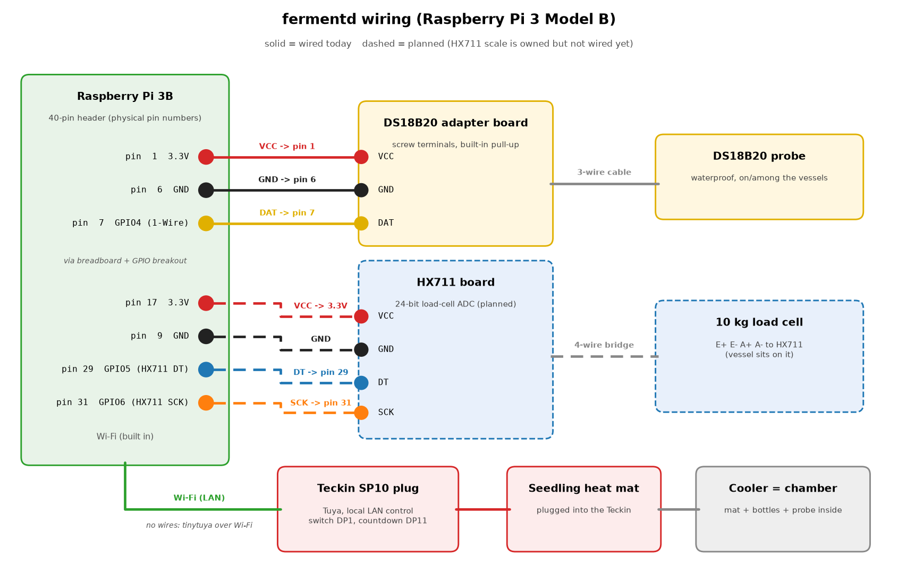

# Hardware

fermentd is built from cheap, easy-to-find parts. Nothing needs soldering: the probe goes into a
screw-terminal adapter, the adapter goes onto a breadboard with a GPIO breakout, and the heat mat
is switched by a Wi-Fi smart plug, so mains power never touches the Pi.



(The diagram is drawn by [`images/wiring.py`](images/wiring.py); run it with matplotlib installed
to regenerate `wiring.svg` and `wiring.png`.)

## Equipment in use

### Electronics

| Part | What it's for |
|---|---|
| Raspberry Pi 3 Model B + microSD card | Runs everything (Raspberry Pi OS Lite 64-bit, Python 3.11+) |
| DS18B20 waterproof temperature probe | Reads the vessel temperature on the 1-Wire bus |
| DS18B20 screw-terminal adapter board | Takes the probe's three wires; has the 4.7 kΩ pull-up resistor built in |
| Breadboard + GPIO breakout (T-cobbler style) | Brings the Pi's header out to the breadboard |
| Teckin SP10 smart plug (Tuya / Smart Life) | Switches the heat mat; controlled locally over Wi-Fi with tinytuya |
| Seedling heat mat | The heat source, under or beside the vessels |
| Cooler | The fermentation chamber: holds heat in and keeps the temperature steady |

### Brewing gear

| Part | What it's for |
|---|---|
| 1-gallon glass jug + airlock | Primary fermentation for cider, wine and other still batches |
| Auto-siphon | Moving liquid off the sediment without disturbing it |
| Bottle filler | Filling bottles from the bottom up with less foam and oxygen |
| Swing-top glass bottles | Carbonating soda and sparkling batches in the bottle |
| Star San | No-rinse sanitizer for everything that touches the batch after boiling |

## Owned, not wired yet

| Part | Plan |
|---|---|
| 10 kg load cell + HX711 board | Weigh a jug while it ferments. CO2 leaving through the airlock shows up as weight loss, which fermentd turns into a live ABV estimate and "fermentation is slowing / probably done" alerts. The software side is finished (driver, tare and calibration from the dashboard or `fermentd-ctl`); it just needs wiring and `scale:` in the vessel's config. |

## Planned / optional

These are ideas, not things fermentd needs or supports today.

- **Cooling: chest freezer or mini fridge** on a relay. Every built-in profile is heat-only today, so
  anything that should ferment below room temperature (lagers, cool cider) needs this first.
- **IoT Relay** (a relay power strip) to switch a freezer or fridge from a GPIO pin.
- **Room air probe**: a second DS18B20 on the same 1-Wire bus (about $3) to show how hard the heater
  is working. The config already has `one_wire.ambient_probe` for it.
- **A plug-in thermostat** between the smart plug and the heat mat, set to about 78°F, as a last line
  of defence that works even if both the Pi and the plug misbehave. Recommended.

## Wiring

### DS18B20 probe (wired)

| Adapter terminal | Pi physical pin | Pi signal |
|---|---|---|
| VCC | pin 1 | 3.3V |
| GND | pin 6 | Ground |
| DAT | pin 7 | GPIO4 (BCM 4), 1-Wire |

Probe colours are usually red = VCC, black/yellow = GND and yellow/white = data, but check the
sheet that came with yours. Enable 1-Wire in `/boot/firmware/config.txt`:

```
dtoverlay=w1-gpio,gpiopin=4
```

After a reboot, `ls /sys/bus/w1/devices/` shows one `28-xxxxxxxxxxxx` entry per probe, and
`fermentd-ctl probes` prints each ROM id with its temperature. More probes can share the same three
wires.

### HX711 scale (planned)

The code defaults (and `fermentd-ctl scale-test` defaults) are:

| HX711 pin | Pi physical pin | Pi signal |
|---|---|---|
| DT (DOUT) | pin 29 | GPIO5 (BCM 5) |
| SCK | pin 31 | GPIO6 (BCM 6) |
| VCC | any 3.3V pin (e.g. pin 17) | 3.3V |
| GND | any ground pin (e.g. pin 9) | Ground |

The load cell's four wires go to the HX711's E+, E-, A+ and A- terminals. The driver reads channel
A at gain 128 using `lgpio` (the `python3-lgpio` package on Raspberry Pi OS) and never touches the
1-Wire pin. Both pins can be changed per vessel with `scale.dout_gpio` / `scale.sck_gpio`.

### Heat mat (wireless)

The Pi talks to the Teckin SP10 over the local Wi-Fi network with tinytuya, no cloud involved once
the local key is known. Two data points are used:

- **DP 1**: the on/off switch.
- **DP 11**: the plug's countdown timer. fermentd sets it to 10 minutes every control cycle while the
  mat is on, so if the Pi or Wi-Fi goes away the plug switches itself off. See
  [control-and-safety.md](control-and-safety.md).

Give the plug a reserved DHCP address on your router so its IP never changes.
